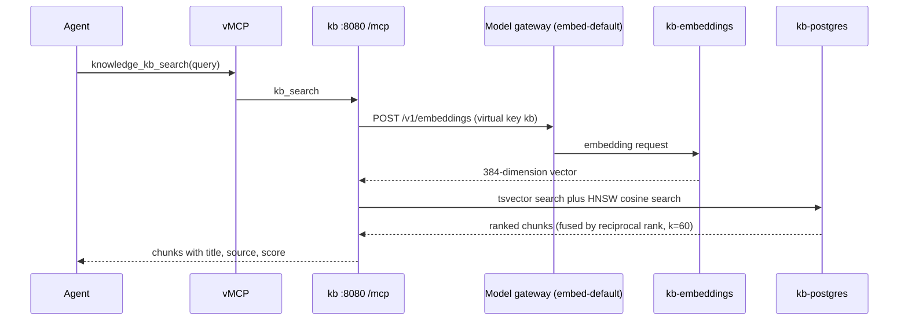

# Knowledge base

## What it is for

Agents need to answer questions from your documents. The knowledge base (`services/kb`, one Go binary) ingests markdown through a token-protected API, splits it into chunks, embeds the chunks on CPU and searches them with lexical and vector ranking combined. Nothing needs an external account: the embedding model runs in the cluster.

## How it works

Namespace `openagentix-knowledge`. Pods: `kb`, `kb-postgres` (`pgvector/pgvector:pg17`, StatefulSet, 2 Gi PVC) and `kb-embeddings` (llama.cpp `server-b10088`, model `bge-small-en-v1.5` GGUF Q8_0, 384 dimensions, 1 Gi PVC for the weights). The kb is one more backend of the vMCP through an `MCPServerEntry` named `knowledge`, so no extra pods are needed for the entry.



- MCP tools in the service: `kb_search` (`query`, `collection`, `top_k`), `kb_get_document` (`document_id`, `collection`), `kb_list_collections`. All are read-only. Agents see `knowledge_kb_search`, `knowledge_kb_get_document` and `knowledge_kb_list_collections`.
- Search results start with a notice that the text is untrusted retrieved data.
- If the query embedding takes longer than `queryEmbedTimeout` (3 s), search falls back to lexical only.
- Admin API: `PUT /v1/collections/<collection>/documents/<id>` (idempotent upsert), `DELETE`, `GET /v1/collections`, with `Authorization: Bearer` and the token from the Secret `kb-admin`. With no token configured the API answers 403.
- Stores: `memory` (dev, tests) and `postgres`. Both pass one conformance suite.

## How to enable and configure

The block is on by default.

```yaml
knowledge:
  enabled: true
  kb:
    chunkMaxChars: 600
    chunkOverlap: 100
    queryEmbedTimeout: 3s
  embeddings:
    enabled: true
    viaGateway: true
    gatewayModel: embed-default
    model: {hf: "CompendiumLabs/bge-small-en-v1.5-gguf:Q8_0", name: bge-small-en-v1.5, dim: 384, pooling: cls}
agents:
  - name: assistant
    knowledge: true
```

`install.sh` creates the Secrets `kb-admin`, `kb-postgres`, `kb-database` and `kb-virtual-key` only when absent, and ingests `components/knowledge/sample/` into the collection `openagentix`. To use a hosted embedder, set `knowledge.embeddings.enabled=false` and `knowledge.kb.embeddings.url`, `.model`, `.dim`, `.apiKeySecret`. Changing the model or its dimension means re-ingesting.

## How to try it

```sh
hack/kb-ingest.sh ./my-docs my-collection        # collection defaults to "openagentix"
```

Then use the A2A command from the [runtime page](./runtime.md) with the question "What is the OpenAgentix knowledge base canary code?". Expect `HERON-4412-KB-RETRIEVED` and a `knowledge_kb_search` call in the task records. The document id comes from the path (`adr/0001-x.md` becomes `adr:0001-x`) and the title from the first heading.

## What was proven

- Semantic hits for queries that share no word with the chunk (full-text match count 0). A paraphrase about a hijacked worker leaking a "language engine supplier passphrase" returned the credentials chunk of the security document first; a roster paraphrase returned the Telegram allowlist chunk first; a third paraphrase ranked a neighbouring chunk first. Margins are small (0.613 against 0.612).
- Footprint (kind): idle `kb` 6 MiB, `kb-embeddings` 110 MiB, `kb-postgres` 64 MiB. Ingesting 17 files (160 KB) took 25 s.
- NetworkPolicy: the kb takes 8080 only from the vMCP pod; PostgreSQL only from the kb; the embedding server only from the gateway proxy. A pod in `default` timed out on all three.
- Hugging Face text-embeddings-inference has no arm64 CPU image, so llama.cpp is used.

## Known limits

- One replica of each piece, no database backups, and the model is downloaded from Hugging Face on first start.
- No egress policy on the kb and its database; no per-collection authorization; the vMCP permit-all Cedar policy applies to the kb tools.
- The lexical half ORs every query word, so common words add noise on a tiny corpus.
- Turning embeddings on for an existing database does not back-fill old chunks.

## Knowledge graph

In progress, design decided: entity/relation extraction at ingest, plain tables in the knowledge base Postgres, recursive SQL, three planned tools `knowledge_kb_graph_search`, `knowledge_kb_graph_entity`, `knowledge_kb_graph_paths`.
