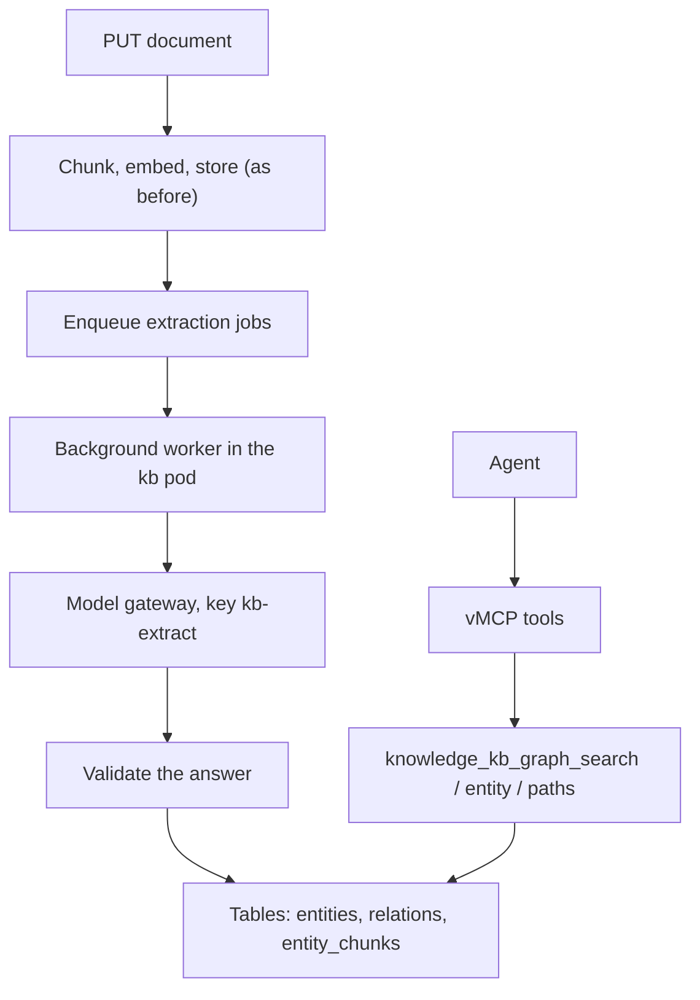
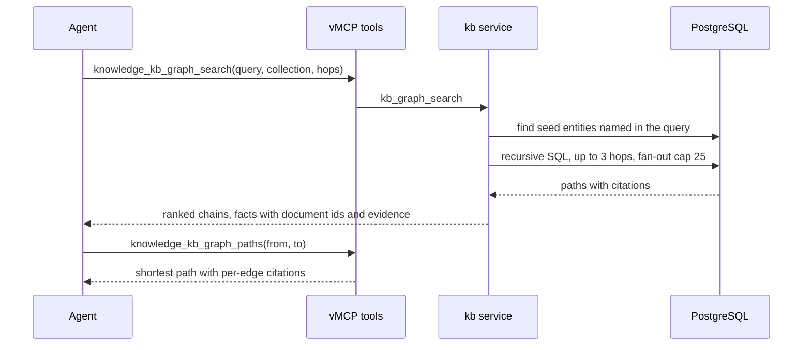

# Knowledge graph

## What it is for

Vector search finds passages that look like the question. It cannot join facts that sit in different documents. Example: one document says which cluster had an outage, another which API stores data there, a third which service calls that API, a fourth who owns the service, a fifth who is on call. No single passage holds the answer.

The knowledge graph stores the links between named things, so an agent can walk from one fact to the next and cite each step.

It is part of the knowledge base service (`services/kb`). It adds no pod and no database: the graph lives in plain tables in the knowledge base PostgreSQL. It is off by default.

## How it works



Ingest:

1. `PUT` of a document returns as before. It does not wait for the graph.
2. A worker takes one window of the document (whole chunks, up to 2400 characters) and sends it to the model through the gateway. The request carries a strict JSON schema and no tools.
3. The answer is validated. A row is kept only when:
   - the entity type is one of `service, team, person, system, location, organization, product, event, concept`;
   - the entity name and the evidence sentence literally occur in the window;
   - the name is a real name, not a generic word ("database", "the wiki", "on-call engineer");
   - a person has a proper name, and an event has a date or number in its name.
4. Entities merge by a canonical name: category words at either end do not count, so `Team Basalt` and `Basalt` are one entity. Type is not part of the key. Entities never merge across collections.
5. Every relation stores its document id, chunk index, evidence sentence, model and prompt version.

Jobs are idempotent and resumable. Re-ingesting unchanged content makes no model call. Changing `promptVersion` re-extracts a document at its next ingest. The worker backs off on HTTP 429 and keeps to an hourly token budget.

Query:



Tools (read-only, registered only when the graph is on):

| Tool as the agent sees it | Arguments | Result |
|---|---|---|
| `knowledge_kb_graph_search` | `query`, `collection`, `hops` (1 to 3), `top_k` | Chains of facts around the entities named in the query, each fact with document id, chunk and evidence |
| `knowledge_kb_graph_entity` | `name`, `collection` | One entity, its aliases and direct neighbours |
| `knowledge_kb_graph_paths` | `from`, `to`, `collection`, `max_hops` | Shortest paths between two entities |

Chains that span more documents rank first. Answers are bounded: 10 chains, 6 passages, 12000 characters. Every answer starts with a notice that the content is untrusted data.

## How to enable

```yaml
knowledge:
  kb:
    graph:
      enabled: true
      extractModel: claude-haiku     # a gateway model alias
      tokensPerHour: 300000          # kb-side budget for extraction
      windowChars: 2400
      maxHops: 3
      promptVersion: v2
```

`install.sh` creates a separate gateway key for extraction (Secret `kb-extract-key`, gateway user `kb-extract`), so a large ingest cannot use up the agents' budget. Agents with `knowledge: true` get the three tools.

Demo values: `components/knowledge/graph-demo-values.yaml`.

## How to try it

```sh
VALUES_FILE="components/knowledge/graph-demo-values.yaml" ./install.sh
hack/kb-graph-canary.sh
```

The canary ingests 26 short fictional documents into the collection `graph-canary`, waits for extraction, prints the vector-search baseline, runs the graph tools and prints PASS or FAIL. It spends model tokens and sends the corpus text to the extraction model.

Operator status, no content: `GET /v1/collections/<collection>/graph/stats` (entities, relations, jobs pending, done, failed, last error code).

## What was proven

On the kind demo cluster with a real model (2026-11-23):

- Extraction: 26 of 26 jobs done, 47,073 tokens, 33 entities, 29 relations.
- Canary PASS: `Vane-3 <- Teal <- Quill <- Orion` and `Orion <- Basalt <- Mira Okafor` found, citing the five chain documents.
- The `assistant` agent answered the five-document question correctly through the tools and listed all five documents. It also explained why a look-alike chain in the same region was not the answer.
- Vector search alone returned on-call and ownership documents but could not link them.

Unit and integration tests cover storage on PostgreSQL, a prompt-injection fixture, restart in the middle of a job, and the upgrade of an existing graph schema.

## Known limits

- Tested on one small fictional corpus. Extraction quality, cost and speed on large real documents are not measured.
- Document text is sent to the extraction model. Choose the model with that in mind.
- The name rules are English only. Two different things with the same proper name in one collection merge.
- Validation proves a relation is grounded in the text, not that it is right. One wrong relation was seen with a real but unrelated evidence sentence. A document can also plant a false fact. Agents must treat graph content as data.
- At most 3 hops per call. Longer questions need two calls, which the tool answer suggests.
- No "summarise the whole corpus" answers, no time-aware edges, no manual curation API yet.
- A failed job stays failed until the document is ingested again.
- The per-key budget size at the gateway is shared by all keys; only the kb-side `tokensPerHour` is specific to extraction.

Decision record: ADR 0004 (`docs/decisions/0004-knowledge-graph.md`).
