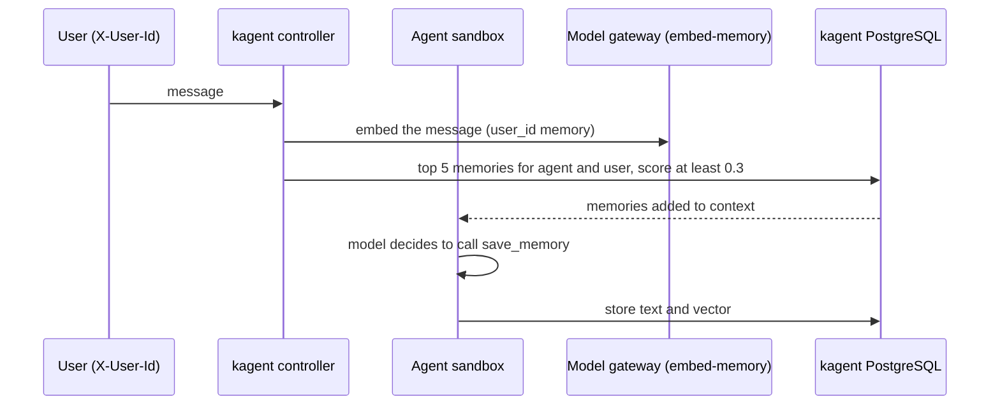
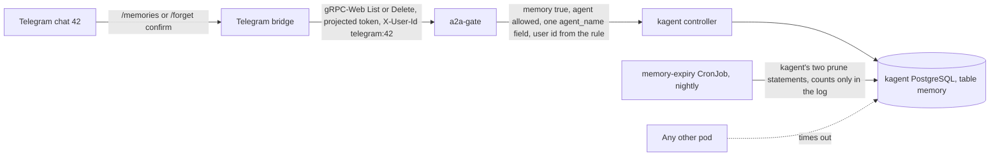

# Memory

## What it is for

An agent with `memory.enabled: true` remembers facts across conversations. This is kagent's own long-term memory (Harness `spec.kagent.memory`). The chart wires it up and keeps its parts behind the same gateway, virtual keys and NetworkPolicies as everything else.

## How it works

- **Saving.** Only what the model decides to save. kagent adds a `save_memory` tool. The chart appends a short paragraph to the system prompt of memory-enabled agents (`memory.agentPrompt`) that tells the model when to call it and never to store secrets.
- **Recall.** On every turn kagent embeds the user's message, takes up to 5 stored memories of the same agent and user with cosine similarity of at least 0.3, and puts them in the context. The model also has a `load_memory` tool.
- **Scope.** One memory space per agent and per user: rows are keyed by the agent (`kagent/assistant`) and the session's user id. In `insecure` auth mode the user id comes from `?user_id=` or the `X-User-Id` header, otherwise kagent's default admin user.
- **Storage.** Table `kagent.memory` in kagent's PostgreSQL, column `extensions.vector(768)`, HNSW cosine index. Needs pgvector there: `components/runtime/pgvector.sh`.



Why a second embedding model: kagent stores `vector(768)` and refuses other sizes, while the knowledge base uses 384. Memory runs its own llama.cpp server with `bge-base-en-v1.5` (768, 118 MB Q8_0) in the namespace `openagentix-memory`. kagent allows one credential per destination origin, so the embedding `ModelConfig` `gateway-embed-memory` reaches the gateway through the `ExternalName` Service `model-gateway-memory`, with its own key `memory-virtual-key`.

## How to enable and configure

```yaml
agents:
  - name: assistant
    memory:
      enabled: true
      ttlDays: 30      # optional; kagent's default is 15
memory:
  namespace: openagentix-memory
  gatewayModel: embed-memory
  embeddings:
    model: {hf: "CompendiumLabs/bge-base-en-v1.5-gguf:Q8_0", name: bge-base-en-v1.5, dim: 768, pooling: cls}
```

The render fails if `memory.embeddings.model.dim` is not 768 or the gateway is disabled. `install.sh` step 3b installs pgvector into kagent's PostgreSQL, sets `config.database.vectorEnabled=true` through `components/runtime/kagent-helm.sh`, and creates `memory-virtual-key`. Enabling it restarts the kagent controller and recompiles the agent revision. An agent without the block renders exactly as before.

## How to try it

Tell the agent a fact in one conversation, then ask for it in a new conversation (no `contextId`) with the same `X-User-Id`. Another user id should not get it. To look at the rows:

```sh
kubectl exec -n kagent kagent-pg-0 -- psql -U postgres -d kagent -c \
  "select agent_name, user_id, left(content,80) as content, expires_at, access_count from kagent.memory"
```

Clear one user: `delete from kagent.memory where agent_name='kagent/assistant' and user_id='<user>'`. Clear all: `truncate kagent.memory`. A Telegram user can do the first for their own chat with `/forget confirm` when `bridge.memoryCommands` is on (see "Memory governance" below).

## What was proven

- A fact told in one conversation was answered correctly in a new one; a second user id and the default user did not get it.
- Existing kagent data was kept when memory was enabled (row counts of agents, sessions, tasks, tools unchanged).
- Per-chat identity for Telegram: the bridge sends `X-User-Id: telegram:<chat id>`. A fact saved under one id was recalled for it and not for another. Before that fix, all Telegram chats shared one space.
- Schedules get their own scope (`schedule:<name>`), and kagent's own scheduler could not do this (ADR 0002).
- Footprint: embedding server 74 MiB idle, 133 MiB after a few calls.
- 30 chart assertions were written first (CHANGELOG).

## Known limits

- `ttlDays` only sets `expires_at`. In kagent 1.0.1 nothing calls the prune function and search ignores `expires_at`, so memories do not expire unless you turn on `memory.expiry` (see "Memory governance" below) or delete them yourself.
- Memory is plain text and vectors in a development PostgreSQL (password auth, no TLS, no encryption at rest). The prompt advice not to store secrets is not a filter.
- A turn fails if the memory backend errors, so keep pgvector on while an agent has memory on.
- Anything that can reach controller port 8083 can claim any user id (with the A2A gate on, only the gate, the egress proxy and the UI pods can).
- A Kourier binding has one fixed user id, so all its conversations share one scope.
- Turning memory off for an agent stops saving and recall but does not delete rows.

## Saving costs a model call (2026-11-24)

kagent 1.0.1 saves a memory only when the model calls `save_memory`, and a tool result always goes back to the model. So every save is a second model call in the same turn: in the benchmark's first turn 1.5 s for the call that chose to save (184 output tokens), 0.1 s for the tool, 0.7 s for the call after it, 16,190 prompt tokens in all. Recall is cheap (embedding 30 to 130 ms, search 20 ms) and was left alone. There is no setting for an automatic or background save in the Go runtime; the periodic save of the Python runtime is not built in.

A prompt that saves only when the user asks to remember something was tested: a fact told in passing is then answered in one call (turn 1 runtime median 3.96 s with 2 calls before, 2.7 s with 1 call after) but is not kept. The owner chose to keep automatic saving as the default; the save-on-request wording is in ADR 0005 for anyone who prefers speed. Recall across conversations was checked in the same test: "Please remember that my project codename is BLUEHERON-42" was recalled in a new conversation of the same user and answered `Unknown` for another user.

## Memory governance (opt-in, ADR 0006 round 3)

Three things were missing: memories never expire, a user cannot see or delete what is stored about them, and a secret that the model saved stays there. Round 3 adds three switches, all off by default. With all of them off, every default and demo render is byte-identical to before.



**1. Expiry (`memory.expiry.enabled`).** A CronJob `memory-expiry` in the `kagent` namespace runs the two statements of kagent's own `PruneExpiredMemories` (`go/core/internal/database/memory.go` lines 125-139, kagent v1.0.1): expired rows that were read at least ten times get fifteen more days and their access count is reset; the other expired rows are deleted. Rows without `expires_at` are left alone. It uses psql from the image of kagent's own database (`pgvector/pgvector:pg17`, pinned by digest, already on the node) and the existing Secret `kagent-postgres-readwrite` by reference: the chart never holds a value of it and the log never shows one. kagent's logins are `NOINHERIT`, so the job runs `SET ROLE kagent_readwrite` after connecting, as kagent does. The log has counts only:

```text
memory-expiry: total_before=N expired=N extended=N deleted=N total_after=N
memory-expiry: secret_scan=on delete=off rows_matching=N rows_deleted=0 patterns=aws_access_key_id=0 bearer_token=0 ...
```

With the job on, a NetworkPolicy `openagentix-kagent-pg` admits only the controller and the job's pods to kagent's PostgreSQL (it was open to every pod). `kubectl exec` into the database pod is not affected.

*Does search return expired rows before the job runs?* Yes. `SearchAgentMemory` and `ListAgentMemories` have no `expires_at` filter (`memory.go` lines 53-66 and 85-101; the comments say "Expired rows remain searchable until pruned"). The integration test shows it with kagent's own search statement against a throw-away database: a user with two expired and two valid rows gets all four back before the job, and the two valid ones after. So with the job on, an expired memory can still be recalled, and listed by `/memories`, until the next run (up to a day with the default schedule `17 3 * * *`); with the job off, for ever. The "ten reads" rule also means a memory that is recalled often keeps living: each turn that recalls it adds one read, and ten reads after the expiry date give it fifteen more days.

**2. `/memories` and `/forget` (`bridge.memoryCommands`).** kagent's `MemoryService` has `List` and `Delete` for the calling user and one agent. They were reachable only by anything that could reach port 8083. Now the bridge answers two commands in a chat, through the A2A gate:

- `/memories` lists what is stored for this chat (at most 10 items of 200 characters, at most 3500 characters, and a count of the rest).
- `/forget` explains and changes nothing. `/forget confirm` deletes everything stored for this chat's user id and the bridge's agent. Conversation history is separate (`/new`).
- In a group chat `/forget` is refused, because the group shares one memory scope and one member would delete it for all. A forwarded message is never taken as one of these commands.

*How the user id is bound.* The two request messages hold one field, `agent_name`. The user is not in the message: kagent takes it from the authenticated principal, which in `insecure` mode is the `X-User-Id` header (`service.go` `managementScope`, `interceptors.go` forwards `x-user-id`). So the gate sets `X-User-Id` from the caller's rule exactly as it does for A2A (the bridge: prefix `telegram:`), and the bridge sends the chat's own id (prefix and chat id, never text). The gate also parses the one gRPC-Web frame: it must hold exactly one string field `agent_name` naming an agent in the rule, nothing else, within 600 bytes; anything it cannot parse is refused, and it forwards the bytes it verified. Only callers whose rule says `memory: true` get these two RPCs; the bridge gets it only with `bridge.memoryCommands`. Everything else on 8083 stays 403, `Search`, `AddSession` and the other services included. The audit line has `rpc` (`MemoryService/List` or `Delete`) and never content.

What the gate cannot do: the bridge may name any chat id that starts with its prefix, because the gate trusts the bridge for which chat sent the command, as it does for A2A. In a group chat, any member can list or forget the group's memories (a group is one identity). The allowlist decides which chats may use the bridge at all.

**3. Secret scan (`memory.expiry.secretScan`, `secretScanDelete`).** During the expiry job, count the memory rows that match ten well-known shapes (private key headers, AWS access key ids, GitHub tokens, Slack tokens, Google API keys, Stripe keys, Telegram bot tokens, provider `sk-` keys, bearer tokens, JWTs), per pattern name. By default it only reports. `secretScanDelete: true` also deletes those rows. The patterns are conservative on purpose: they find a pasted key, not every secret. A row that matches can have been recalled into a model context already; deleting it later does not undo that. The job never logs the text.

```yaml
bridge: {memoryCommands: true}          # needs governance.a2a.enabled
memory:
  expiry: {enabled: true, schedule: "17 3 * * *", secretScan: true, secretScanDelete: false}
```

Try it: `components/governance/memory-demo-values.yaml` (needs the gate demo). Run the job once by hand: `kubectl create job -n kagent --from=cronjob/memory-expiry memory-expiry-manual`, read `kubectl logs -n kagent job/memory-expiry-manual`, delete the job. The SQL is tested against a throw-away PostgreSQL that the test starts and stops itself: `charts/openagentix/tests/memory-expiry-integration.sh`. Evidence from the live run is in ADR 0006, "Round 3 results".

