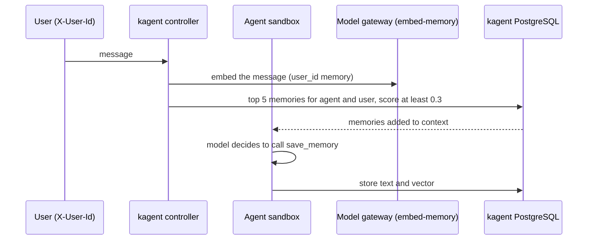

# Memory

## What it is for

An agent with `memory.enabled: true` remembers facts across conversations. This is kagent's own long-term memory (Harness `spec.kagent.memory`). The chart wires it up and keeps its parts behind the same gateway, virtual keys and NetworkPolicies as everything else.

## How it works

- **Saving.** Only what the model decides to save. kagent adds a `save_memory` tool. The chart appends a short paragraph to the system prompt of memory-enabled agents (`memory.agentPrompt`) that tells the model when to call it and never to store secrets.
- **Recall.** On every turn kagent embeds the user's message, takes up to 5 stored memories of the same agent and user with cosine similarity of at least 0.3, and puts them in the context. The model also has a `load_memory` tool.
- **Scope.** One memory space per agent and per user: rows are keyed by the agent (`kagent/assistant`) and the session's user id. In `insecure` auth mode the user id comes from `?user_id=` or the `X-User-Id` header, otherwise kagent's default admin user.
- **Storage.** Table `kagent.memory` in kagent's PostgreSQL, column `extensions.vector(768)`, HNSW cosine index. Needs pgvector there: `components/runtime/pgvector.sh`.



Why a second embedding model: kagent stores `vector(768)` and refuses other sizes, while the knowledge base uses 384. Memory runs its own llama.cpp server with `bge-base-en-v1.5` (768, 118 MB Q8_0) in the namespace `openagentix-memory`. kagent allows one credential per destination origin, so the embedding `ModelConfig` `gateway-embed-memory` reaches the gateway through the `ExternalName` Service `model-gateway-memory`, with its own key `memory-virtual-key`.

## How to enable and configure

```yaml
agents:
  - name: assistant
    memory:
      enabled: true
      ttlDays: 30      # optional; kagent's default is 15
memory:
  namespace: openagentix-memory
  gatewayModel: embed-memory
  embeddings:
    model: {hf: "CompendiumLabs/bge-base-en-v1.5-gguf:Q8_0", name: bge-base-en-v1.5, dim: 768, pooling: cls}
```

The render fails if `memory.embeddings.model.dim` is not 768 or the gateway is disabled. `install.sh` step 3b installs pgvector into kagent's PostgreSQL, sets `config.database.vectorEnabled=true` through `components/runtime/kagent-helm.sh`, and creates `memory-virtual-key`. Enabling it restarts the kagent controller and recompiles the agent revision. An agent without the block renders exactly as before.

## How to try it

Tell the agent a fact in one conversation, then ask for it in a new conversation (no `contextId`) with the same `X-User-Id`. Another user id should not get it. To look at the rows:

```sh
kubectl exec -n kagent kagent-pg-0 -- psql -U postgres -d kagent -c \
  "select agent_name, user_id, left(content,80) as content, expires_at, access_count from kagent.memory"
```

Clear one user: `delete from kagent.memory where agent_name='kagent/assistant' and user_id='<user>'`. Clear all: `truncate kagent.memory`.

## What was proven

- A fact told in one conversation was answered correctly in a new one; a second user id and the default user did not get it.
- Existing kagent data was kept when memory was enabled (row counts of agents, sessions, tasks, tools unchanged).
- Per-chat identity for Telegram: the bridge sends `X-User-Id: telegram:<chat id>`. A fact saved under one id was recalled for it and not for another. Before that fix, all Telegram chats shared one space.
- Schedules get their own scope (`schedule:<name>`), and kagent's own scheduler could not do this (ADR 0002).
- Footprint: embedding server 74 MiB idle, 133 MiB after a few calls.
- 30 chart assertions were written first (CHANGELOG).

## Known limits

- `ttlDays` only sets `expires_at`. In kagent 1.0.1 nothing calls the prune function and search ignores `expires_at`, so memories do not expire. Delete them yourself.
- Memory is plain text and vectors in a development PostgreSQL (password auth, no TLS, no encryption at rest). The prompt advice not to store secrets is not a filter.
- A turn fails if the memory backend errors, so keep pgvector on while an agent has memory on.
- Anything that can reach controller port 8083 can claim any user id.
- A Kourier binding has one fixed user id, so all its conversations share one scope.
- Turning memory off for an agent stops saving and recall but does not delete rows.

## Saving costs a model call (2026-11-24)

kagent 1.0.1 saves a memory only when the model calls `save_memory`, and a tool result always goes back to the model. So every save is a second model call in the same turn: in the benchmark's first turn 1.5 s for the call that chose to save (184 output tokens), 0.1 s for the tool, 0.7 s for the call after it, 16,190 prompt tokens in all. Recall is cheap (embedding 30 to 130 ms, search 20 ms) and was left alone. There is no setting for an automatic or background save in the Go runtime; the periodic save of the Python runtime is not built in.

A prompt that saves only when the user asks to remember something was tested: a fact told in passing is then answered in one call (turn 1 runtime median 3.96 s with 2 calls before, 2.7 s with 1 call after) but is not kept. The owner chose to keep automatic saving as the default; the save-on-request wording is in ADR 0005 for anyone who prefers speed. Recall across conversations was checked in the same test: "Please remember that my project codename is BLUEHERON-42" was recalled in a new conversation of the same user and answered `Unknown` for another user.
