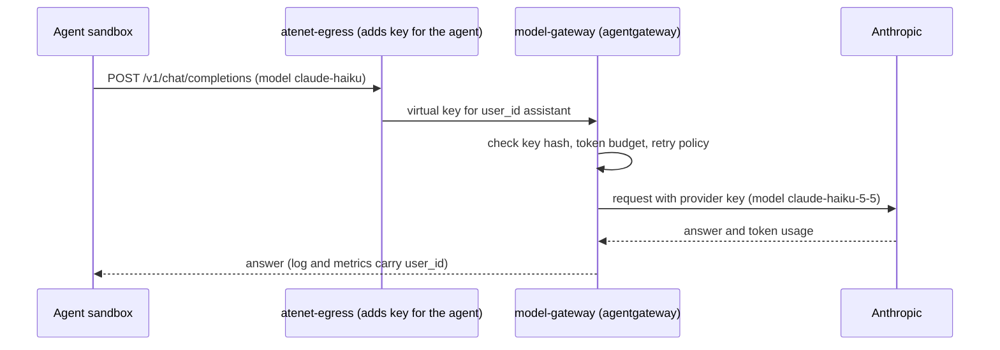

# Model gateway

## What it is for

Agents must never hold a provider key. The model gateway is agentgateway v1.7.0. It holds the one provider key (an Anthropic key in the demo), checks a virtual key per agent, applies a token budget per key and labels logs and metrics with the key's `user_id`. Models are chosen by the `model` field of an OpenAI-style request, using the `AgentgatewayModel` API.

## How it works



- Endpoint in cluster: `http://model-gateway.agentgateway-system.svc.cluster.local/v1` (port 80).
- Kubernetes objects: `Gateway` `model-gateway` (class `agentgateway`), one `AgentgatewayModel` per entry of `gateway.models`, and exactly one `AgentgatewayPolicy` named `model-gateway-policy`. The docs warn that several policies on one Gateway can overwrite each other, so auth, budget and retry live in one policy.
- Virtual keys: `install.sh` creates a Secret `<agent>-virtual-key` in `kagent`, and adds its SHA-256 hash to the ConfigMap `llm-api-keys` in `agentgateway-system` (label `agentgateway.dev/apikey`). The chart renders a `ModelConfig` per agent that points at that Secret. Keys are random and never printed.
- Extra keys: `kb-virtual-key` (user `kb`) and `memory-virtual-key` (user `memory`).
- Embeddings: `AgentgatewayModel` `embed-default` (knowledge base, 384 dimensions) and `embed-memory` (kagent memory, 768 dimensions) route `/v1/embeddings` to llama.cpp servers. kagent allows one credential per destination origin, so memory reaches the gateway through an `ExternalName` Service `model-gateway-memory`.
- Failover: priority groups, with `policies.health.unhealthyCondition` including 402 and 429, plus the retry policy. Without retry, the request that finds the dead primary is returned to the client.

## How to enable and configure

Real keys from `charts/openagentix/values.yaml`:

```yaml
gateway:
  enabled: true
  models:
    - name: claude-haiku
      provider: Anthropic
      authSecret: anthropic-api-key      # key name inside the Secret must be Authorization
      upstreamModel: claude-haiku-5-5
  policy:
    name: model-gateway-policy
    tokenBudget: {tokens: 1000000, unit: Hours}   # per virtual key, per proxy replica
    retry: {attempts: 2, codes: [402, 429, 500, 502, 503, 504]}
    attributeUserId: true
```

To add a model, add an entry to `gateway.models` and create its provider Secret in `agentgateway-system`. A commented Gemini example and a failover example are in `values.yaml`.

## How to try it

Cost and tokens per agent (needs the observability profile, see [observability](./observability.md)):

```
sum by (user_id)(increase(agentgateway_gen_ai_client_cost_usd_total[1h]))
sum by (user_id, gen_ai_token_type)(increase(agentgateway_gen_ai_client_token_usage_sum[1h]))
```

A request to `/v1/embeddings` without a key, or with a wrong key, gets 401.

## What was proven

- Without a key or with a wrong key: 401. With a key: 200 (components/model-gateway/NOTES.md).
- Per-key budget: with `tokens: 40/Minutes`, one key got 200, 200, 200 and then 429 while another key still got 200. In the runtime comparison the budget of 100000 per hour throttled kagent seven times; it was then raised to 1000000.
- Cost metric: the log's per-request cost equals 0.10 USD per million input tokens and 0.50 per million output tokens for `claude-haiku-5-5`. Ten calls matched the metric (0.0167587 USD).
- Failover: a 402 from Gemini was retried to the stub model (`retry.attempt=2`).
- Embedding routes answered with `user_id="kb"` and `user_id="memory"` in the access log.
- Footprint: controller 36 MiB and proxy 18 MiB at idle (spike measurement).

## Known limits

- Budgets are in tokens, per proxy replica. No USD caps were found. Cross-replica limits need an external rate-limit service (not tested).
- Virtual keys are static, with no rotation or expiry. Gateway traffic is plain HTTP inside the cluster.
- One Anthropic key is shared by every agent; attribution is by virtual key only.
- Gemini has not produced a real completion in this project (the test key had no credits). The Gemini and failover entries are examples.
- Cost is only computed for models in the gateway's built-in catalog. A model missing from it has no cost.
- Multiple proxy replicas, HTTPS, streaming failover and the built-in cost dashboard were not tried.
- "Intelligent routing" and cost-based routing are not built. No comparison with LiteLLM or other routers is recorded in the repository.

## Prompt caching (2026-11-24)

Calls from `assistant` carry about 8,000 prompt tokens and no call reported a cache read. The cause was simple: agentgateway adds Anthropic cache marks only when the policy says so, and kagent's OpenAI-compatible request has none. The switch is `AgentgatewayPolicy.spec.backend.ai.promptCaching` (checked in the installed CRD; the model object has no such field). The chart now renders it in the one policy: `gateway.policy.promptCaching`, on by default, with the tool list, the system prompt and the conversation marked.

Measured on a calm node, new conversation per run, 8,000-token prompts: cache read 6,635 tokens on every call (7 of 7, seven different users), a second call in the same turn reads 8,036 of 8,070, cost per call from the gateway's price catalog 0.000803 USD before and 0.000209 USD after (74% less). The model call time did not change (median 0.715 s before, 0.753 s after), so the gain is cost, not speed. The gateway keeps `cache_creation` and `cache_read` in its spans and metrics; kagent's own usage shows 0 because its chat adapter does not read the cached count. Read cache numbers from the gateway.

Limits: an entry lives 5 minutes, and the call that writes it costs 25% more. kagent puts the recalled memories into the system prompt after the static text, so when a memory is recalled only the tools and the static head of the prompt are cached. The per-key token budget counts the full prompt: about 125 calls of 8,000 tokens used the 1,000,000 tokens per hour of one key, and the next answer was `429 Too Many Requests`.
