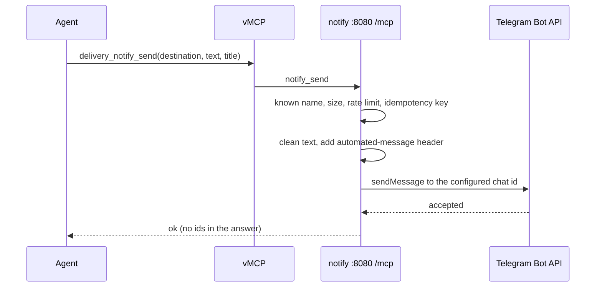

# Notify

## What it is for

Agents started by a webhook or a schedule have no reply route. The notify service (`services/notify`, Go) gives them one without giving them the keys. An operator lists named destinations (a Telegram chat, a Slack channel, a signed webhook). An agent can only say "send this text to `owner-telegram`". It never sees, and cannot choose, a chat id, channel id, URL or token.

## How it works

Namespace `openagentix-notify`. One replica (strategy Recreate). The service is one more vMCP backend: an `MCPServerEntry` named `delivery` plus an `unauthenticated` `MCPExternalAuthConfig`.



- Agent-visible tools: `delivery_notify_send` (arguments `destination`, `text`, optional `title` and `idempotency_key`) and `delivery_notify_list_destinations` (names, platform, description; never ids).
- Destinations live in a Secret, not in values: `notify.destinations.existingSecret` (default `notify-destinations`, key `destinations.yaml`) mounted at `/etc/notify/destinations.yaml`. Tokens come from existing Secrets listed in `notify.tokens` (`env`, `secret`, `key`).
- Guardrails in the service: only configured names; every message starts with a line saying it comes from an automated agent; control, bidirectional and invisible characters removed; mentions, commands, hashtags and links neutralised on Telegram and escaped on Slack; size limit; rate limit per destination (default 6 per minute, 60 per hour) and a global cap; message text never logged; redirects and proxies not followed.
- Network: port 8080 only from the vMCP pods; egress DNS and TCP 443 to public addresses.
- With no destination the service starts, refuses every call and reports not ready. `notify.requireReady: false` makes readiness `/healthz` so `helm --wait` does not block.

## How to enable and configure

Off by default (`notify.enabled: false`; the default render is unchanged). An agent opts in with `agents[].notify`:

```yaml
notify: {enabled: true}
agents:
  - name: assistant
    notify: {enabled: true}     # adds the two tools and a short prompt addition
```

```sh
TELEGRAM_ALLOWED_CHAT_IDS=<your chat id> NOTIFY_TELEGRAM_CHAT_ID=<your chat id> \
VALUES_FILE="components/channels/demo-values.yaml components/schedules/demo-values.yaml components/notify/demo-values.yaml" ./install.sh
```

`install.sh` builds `openagentix/notify:dev` (`SKIP_NOTIFY_IMAGE=1` skips it) and creates the Secrets `notify-destinations` and `notify-credentials` only when absent, with one destination `owner-telegram`, from `NOTIFY_TELEGRAM_CHAT_ID` or from the first allowlist id when `NOTIFY_OWNER_TELEGRAM=1`. Without one of the two, nothing is created. To add a destination, edit the Secret and run `kubectl rollout restart deployment/notify -n openagentix-notify` (the file is read once at start). The entry name is the tool prefix (`notify.mcp.entryName`, default `delivery`).

## How to try it

Run the demo schedule once (`kubectl create job -n openagentix-schedules --from=cronjob/demo-brief demo-brief-manual-1`) and watch your chat. Or send the signed webhook of the [channels page](./channels.md) with an event `report.requested` on channel `demo-notify` and a `deliver_to` field naming a destination (the demo binding `demo-assistant-notify`).

## What was proven

- On kind with the real Telegram API: a direct tool call, an A2A question, the demo schedule and a signed webhook all delivered to the owner's chat (ADR 0002 note). "Delivered" means the Telegram API accepted the message.
- Sending and the bridge's long polling do not conflict: no 409 in the bridge log.
- NetworkPolicy: a pod in `default` and a non-vMCP pod in `mcp-tools` timed out.
- A security review led to a hardening commit (`68120de`). Unit tests cover the guardrails, and assert no ids or tokens appear in logs or errors.

## Known limits

- Slack and webhook destination types are built and unit-tested, not run live.
- Whoever can edit the destinations Secret decides where agents can post; whoever can read it learns the chat ids.
- The vMCP Cedar policy is permit-all by default and kagent identity is per session, so the per-agent opt-in limits which agents are offered the tools, not who can call the vMCP.
- One replica: rate limits and idempotency keys are in memory and reset on restart. Callers are not told apart.
- A prompt-injected agent can still send a misleading message to an allowed destination.
- kindnet does not enforce the internet egress rule. NetworkPolicy matches addresses, not host names.
- Telegram bare domains, e-mail addresses and phone numbers are not neutralised.
- Not done: a Slack run, alerting for failed schedule runs, per-agent authorization at the vMCP.
