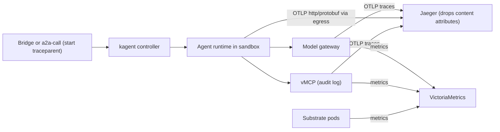

# Observability

## What it is for

One user message crosses many hops. Observability answers "what did agent X cost today?" and "where did the 40 seconds of that turn go?". It is off by default (`observability.enabled: false`; the default render is unchanged). Design and evidence: ADR 0003.

## How it works

Two layers, one switch. The wiring works with any OTLP and Prometheus stack. An optional bundled dev profile adds VictoriaMetrics v1.156.0 and Jaeger v2.23.0 in `openagentix-observability`.



- **Cost and tokens.** The gateway labels metrics with `user_id` = the virtual-key name (`assistant`, `kb`, `memory`), never a person. Metrics: `agentgateway_gen_ai_client_cost_usd_total`, `agentgateway_gen_ai_client_token_usage_sum`. Tool calls: `toolhive_mcp_tool_calls_total`.
- **Trace.** The bridge and `a2a-call` start a W3C `traceparent`. It survives controller, Substrate router, sandbox, egress proxy and gateway. The vMCP continues the trace.
- **Correlation key.** The A2A `contextId` equals the kagent session id and the Substrate actor `session-<contextId>`.
- **Audit.** The vMCP writes `AUDIT` lines (tool, outcome, `actor/kagent/session-<contextId>`, duration), never arguments or results.
- **Privacy.** Content capture is off. One value, `observability.capture.content`, is the only way to turn it on. Baggage is off. The Go ADK and the vMCP write tool arguments and results into spans whatever the setting; the bundled Jaeger deletes those attributes and `user.id` before storage. With your own endpoint the chart exports only gateway spans until you set `observability.otlp.contentFiltered: true`.
- `install.sh` configures what the chart does not own (kagent controller and runtimes through `spikes/kagent/kagent-helm.sh`, Agent Kourier OTLP env and scrape policy) from a marker ConfigMap `openagentix-observability`, only when they differ.

## How to enable and configure

```sh
VALUES_FILE="components/observability/demo-values.yaml" ./install.sh     # add your other values files too
```

```yaml
observability:
  enabled: true
  bundled: {enabled: true}
# your own stack instead:
#  otlp: {endpoint: http://collector.monitoring.svc:4318, protocol: http/protobuf, contentFiltered: false}
#  metrics: {scrape: {namespace: monitoring}}
```

Other keys: `tracing.samplingRate` (default "1.0"), `audit.enabled`, `baggage`, `bundled.traces.maxTraces` (2000), `bundled.metrics.retention` (7d). PodMonitors render only when the `monitoring.coreos.com/v1` API exists.

## How to try it

```sh
kubectl port-forward -n openagentix-observability svc/victoria-metrics 8428:8428    # /vmui
kubectl port-forward -n openagentix-observability svc/jaeger 16686:16686
hack/trace-turn.sh <traceId or contextId>     # read-only per-turn summary
```

Example output: `model: 2 calls 3.2s tokens in=30782 out=263 models=claude-haiku-5-5 cost=$0.00321`, then memory, tools and notify lines. Without Jaeger the script falls back to the egress proxy log. The bridge logs one `turn` line per message with `trace_id`; `a2a-call` prints `traceId` and `contextId`. Query: `sum by (user_id)(increase(agentgateway_gen_ai_client_cost_usd_total[1h]))`.

## What was proven

- Cost: ten calls, 153802 input and 2757 output tokens, 0.0167587 USD in the log; token series matched exactly.
- Trace: one A2A request produced one trace with 59 spans from four services (controller, `assistant`, vMCP `tools`, `model-gateway`). Over http/protobuf the sandbox reached the collector through `atenet-egress` with no hand-written policy.
- A throwaway Job with the schedule pod spec produced a trace with 55 spans.
- Content: with the Jaeger filter removed, stored traces held tool arguments; with it, 0 matching keys among 55 spans.
- Footprint: node memory requests +144 Mi; VictoriaMetrics 153 to 156 MB, Jaeger 27 to 34 MB working set.

## Known limits

- **Cluster stall.** The first roll of the kagent controller with new telemetry values coincided with about 20 minutes of load average above 100: API server and kubelet timeouts, `ate-idp-server` and the controller crash-looped on lost leader election until pods were deleted by hand. Cause not established. Do the first enable when nobody uses the demo.
- Not exercised: OTLP over gRPC, baggage on, Kourier traces, the live Telegram path. PodMonitors were rendered and unit-tested only.
- Jaeger keeps 2000 traces in memory; they are lost on restart. No authentication on the UIs beyond the port-forward.
- No dashboards, no alerts, no per-user view. `user.id` is dropped from stored spans. kb and notify emit nothing yet.
- First hour after install reads high for cost, because VictoriaMetrics counts the first value of a new series as an increase.
- No USD budget caps; the audit log is pod stdout, not tamper-evident.
