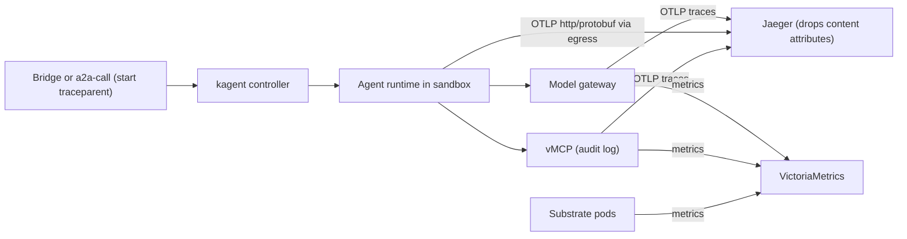

# Observability

## What it is for

One user message crosses many hops. Observability answers "what did agent X cost today?" and "where did the 40 seconds of that turn go?". It is off by default (`observability.enabled: false`; the default render is unchanged). Design and evidence: ADR 0003.

## How it works

Two layers, one switch. The wiring works with any OTLP and Prometheus stack. An optional bundled dev profile adds VictoriaMetrics v1.156.0 and Jaeger v2.23.0 in `openagentix-observability`.



- **Cost and tokens.** The gateway labels metrics with `user_id` = the virtual-key name (`assistant`, `kb`, `memory`), never a person. Metrics: `agentgateway_gen_ai_client_cost_usd_total`, `agentgateway_gen_ai_client_token_usage_sum`. Tool calls: `toolhive_mcp_tool_calls_total`.
- **Trace.** The bridge and `a2a-call` start a W3C `traceparent`. It survives controller, Substrate router, sandbox, egress proxy and gateway. The vMCP continues the trace.
- **Correlation key.** The A2A `contextId` equals the kagent session id and the Substrate actor `session-<contextId>`.
- **Audit.** The vMCP writes `AUDIT` lines (tool, outcome, `actor/kagent/session-<contextId>`, duration), never arguments or results.
- **Privacy.** Content capture is off. One value, `observability.capture.content`, is the only way to turn it on. Baggage is off. The Go ADK and the vMCP write tool arguments and results into spans whatever the setting; the bundled Jaeger deletes those attributes and `user.id` before storage. With your own endpoint the chart exports only gateway spans until you set `observability.otlp.contentFiltered: true`.
- `install.sh` configures what the chart does not own (kagent controller and runtimes through `components/runtime/kagent-helm.sh`, Agent Kourier OTLP env and scrape policy) from a marker ConfigMap `openagentix-observability`, only when they differ.

## How to enable and configure

```sh
VALUES_FILE="components/observability/demo-values.yaml" ./install.sh     # add your other values files too
```

```yaml
observability:
  enabled: true
  bundled: {enabled: true}
# your own stack instead:
#  otlp: {endpoint: http://collector.monitoring.svc:4318, protocol: http/protobuf, contentFiltered: false}
#  metrics: {scrape: {namespace: monitoring}}
```

Other keys: `tracing.samplingRate` (default "1.0"), `audit.enabled`, `baggage`, `bundled.traces.maxTraces` (2000), `bundled.metrics.retention` (7d). PodMonitors render only when the `monitoring.coreos.com/v1` API exists.

## How to try it

```sh
kubectl port-forward -n openagentix-observability svc/victoria-metrics 8428:8428    # /vmui
kubectl port-forward -n openagentix-observability svc/jaeger 16686:16686
hack/trace-turn.sh <traceId or contextId>     # read-only per-turn summary
```

Example output: `model: 2 calls 3.2s tokens in=30782 out=263 models=claude-haiku-5-5 cost=$0.00321`, then memory, tools and notify lines. Without Jaeger the script falls back to the egress proxy log. The bridge logs one `turn` line per message with `trace_id`; `a2a-call` prints `traceId` and `contextId`. Query: `sum by (user_id)(increase(agentgateway_gen_ai_client_cost_usd_total[1h]))`.

## What was proven

- Cost: ten calls, 153802 input and 2757 output tokens, 0.0167587 USD in the log; token series matched exactly.
- Trace: one A2A request produced one trace with 59 spans from four services (controller, `assistant`, vMCP `tools`, `model-gateway`). Over http/protobuf the sandbox reached the collector through `atenet-egress` with no hand-written policy.
- A throwaway Job with the schedule pod spec produced a trace with 55 spans.
- Content: with the Jaeger filter removed, stored traces held tool arguments; with it, 0 matching keys among 55 spans.
- Footprint: node memory requests +144 Mi; VictoriaMetrics 153 to 156 MB, Jaeger 27 to 34 MB working set.

## Round 2: metrics from kb and notify, and a dashboard without a new pod

Our own two Go services now expose Prometheus metrics, and a single static page draws them next to the gateway and vMCP series. **Built and tested offline (Go tests, chart render tests, a fake Prometheus API, a jsdom run of the page). Not yet run on the cluster.**

- **Switch.** With `observability.enabled` the chart sets `KB_METRICS_ADDR` and `NOTIFY_METRICS_ADDR` (port 9090, values `knowledge.kb.metrics.port` and `notify.metrics.port`) and declares a container port named `metrics`. Without it the services start no metrics listener and the render is byte-identical to before. `/metrics` is on a separate listener from the API, serves nothing else, and has no authentication. The Services never expose it.
- **Who may scrape.** The two new targets (`when: knowledge`, `when: notify`) join the same list that feeds the PodMonitors and the bundled VictoriaMetrics scrape config. A NetworkPolicy (`kb-metrics`, `notify-metrics`) lets only the bundled VictoriaMetrics pods reach port 9090, exactly as round 1 did for the vMCP. With your own Prometheus behind the PodMonitors you must add a policy for it if `networkPolicy.enabled` is true.
- **Privacy.** Labels come from closed sets. There is no document text, query, prompt, message text, chat id, destination address, destination name, collection name (by default) or end-user id in any label or log. Tests put canary strings into documents, queries, messages, destination names, chat ids and tokens and assert that none of them appears in `/metrics` or in the logs.
- **kb series** (`openagentix_kb_`): `http_requests_total` and `http_request_duration_seconds` by route template, method and status class; `mcp_tool_calls_total` and `mcp_tool_call_duration_seconds` by tool and outcome; `search_requests_total` and `search_duration_seconds` by mode (`lexical`, `hybrid`) and outcome; `embedder_calls_total` and `embedder_call_duration_seconds` by operation (`batch`, `query`) and outcome; `documents_ingested_total` by outcome; graph: `graph_jobs_total` by state, `graph_model_calls_total` by outcome and error code, `graph_extraction_tokens_total`, `graph_budget_paused_seconds_total`, and the gauges `graph_jobs_pending`, `graph_entities`, `graph_relations`, `graph_factsets` (sampled at scrape time, cached 15 seconds, one series `collection="all"`; `knowledge.kb.metrics.collectionLabels: true` uses the collection name instead, capped at 50).
- **notify series** (`openagentix_notify_`): `sends_total` and `send_duration_seconds` by platform kind (`telegram`, `slack`, `webhook`, `unknown`) and outcome (`delivered`, `duplicate`, `rejected_validation`, `rate_limited`, `unknown_destination`, `upstream_error`, `busy`, `uncertain`); `rate_limit_rejections_total` by scope (`destination`, `global`); `payload_rejections_total` by kind and field; `mcp_tool_calls_total` and `mcp_tool_call_duration_seconds` by tool and outcome. Destination names are not labels: they are operator-chosen and can name a person, and the service log already carries them.
- **Both:** `go_goroutines`, `go_memstats_alloc_bytes`, `process_start_time_seconds`, `openagentix_<service>_build_info{version}`.
- **Why no client library.** Neither module had `prometheus/client_golang`. A small text-exposition package (counters, gauges, fixed-bucket histograms, label escaping, a per-metric series cap) is kept as an identical copy in `services/kb/internal/metrics` and `services/notify/internal/metrics`. The services are separate Go modules built from their own directory, so a shared module would need a replace directive and a wider Docker context; a test in notify fails if the copies differ.

### The dashboard

```sh
hack/dashboard.sh              # port-forwards the bundled VictoriaMetrics, serves http://127.0.0.1:8765
hack/dashboard.sh --check      # runs every PromQL query of the page, exit 1 on a query error
hack/dashboard.sh --check --url http://127.0.0.1:8428    # the same against an API you already reach
```

It adds no pod. The script port-forwards VictoriaMetrics (and the Jaeger UI when it exists, as a link), then serves `hack/dashboard/index.html` and proxies the read-only query API with `python3` from the standard library. The page and its queries share one origin, so no CORS header is needed or relied on, and the page sends a policy that allows no other origin. Panels: cost per agent (1 hour or 24 hours), tokens per agent, model requests and error rate, tool calls by tool and outcome, kb searches and latency, graph extraction, notify sends by outcome, and scrape target health. Each shows its PromQL. A panel with no series says "no data yet"; a failed query says so and the others still draw. The cost panel repeats the first-sample caveat above. The script refuses to start without the observability namespace and the `victoria-metrics` service, and leaves no process behind.

Tested offline: `hack/dashboard/tests/run.sh` (a fake Prometheus API, a fake kubectl, the real proxy, and the page in jsdom with data, with no data and with one failing query, asserting that no request leaves localhost). Not verified: the queries against a real VictoriaMetrics (label names such as `status` on `agentgateway_requests_total` are assumed), what VictoriaMetrics sends as CORS headers, and the NetworkPolicies on a real cluster.

## Known limits

- **Cluster stall.** The first roll of the kagent controller with new telemetry values coincided with about 20 minutes of load average above 100: API server and kubelet timeouts, `ate-idp-server` and the controller crash-looped on lost leader election until pods were deleted by hand. Cause not established. Do the first enable when nobody uses the demo.
- Not exercised: OTLP over gRPC, baggage on, Kourier traces, the live Telegram path. PodMonitors were rendered and unit-tested only.
- Jaeger keeps 2000 traces in memory; they are lost on restart. No authentication on the UIs beyond the port-forward.
- No alerts, no per-user view, no Grafana. `user.id` is dropped from stored spans. The kb and notify metrics and the local dashboard (round 2, below) are built and tested offline and have not run on the cluster yet.
- First hour after install reads high for cost, because VictoriaMetrics counts the first value of a new series as an increase.
- No USD budget caps; the audit log is pod stdout, not tamper-evident.
