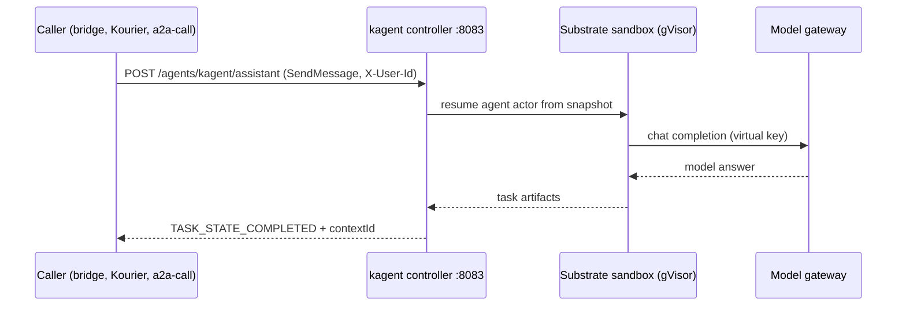

# Runtime

## What it is for

The runtime runs the agent loop: it takes a message, calls the model, calls tools, keeps the conversation and returns an answer. OpenAgentix uses kagent 1.0.1 on Agent Substrate 1.0.1. Substrate runs each agent in a gVisor sandbox and can snapshot and resume it.

## How it works

The chart renders four kagent objects per agent: a `Harness`, an `AgentTemplate`, an `Agent` and a `ModelConfig` (API group `api.kagent.dev/v1alpha3`). Callers talk A2A 1.0 (JSON-RPC `SendMessage`) to the kagent controller on port 8083.



Facts from the spike notes:
- The answer is in `task.artifacts[0].parts[0].text`. A failure is HTTP 200 with `TASK_STATE_FAILED`, so clients must check the state, not the status code.
- The `contextId` is assigned on the first turn. Send it back to continue the conversation.
- A new agent takes 1 to 2 minutes to become Ready while its golden snapshot is built. Editing a `ModelConfig` re-snapshots the agent (15 to 20 seconds).
- Sandbox DNS does not apply search domains: use full `*.svc.cluster.local` names.

## Why kagent and not Google AX

ADR 0001 (accepted). The same agent was built on AX and measured against kagent, five runs per prompt, all on `claude-haiku-5-5`.

| Prompt | kagent | AX with Claude Code | AX with a 200-line loop |
|---|---|---|---|
| Plain question | 5/5, median 12.2 s | 5/5, 7.1 s | 5/5, 4.1 s |
| Tool call (OSV) | 3/3, 16.0 s | 5/5, 10.7 s | 5/5, 8.3 s |
| Skill (canary) | 5/5, 6.5 s | 5/5, 7.4 s | 5/5, 5.7 s |
| Three-turn memory | 5/5, 31.3 s | 5/5, 18.1 s | 5/5, 11.5 s |

AX answered every prompt correctly and was not slower. The decision does not rest on speed. It rests on what would have to be built on AX: a declarative agent (AX has `Task`, not an agent kind), the agent loop, conversation history, Kubernetes-native resources (AX kinds are database rows, not CRDs), and published images. kagent has all of these. kagent's only failures were seven 429 answers from the gateway's own token budget. The loops differ between the backends, so the timings do not isolate the runtime.

AX is better at egress lockdown with credential injection, process checkpointing and one-shot jobs. Revisit if AX adds task messaging, an `Agent` spec and sessions, and published images. The adapter `bridges/ax-adapter/` stays experimental and is not installed.

## How to enable and configure

Agents are entries in the `agents` list of `charts/openagentix/values.yaml`. Keys used by the demo `assistant`: `name`, `description`, `model` (a name from `gateway.models`), `modelConfigName`, `systemPrompt`, `tools`, `skills`, `knowledge`, `memory`. Runtime block `kagent`: `namespace: kagent`, `workerPool: kagent-default`, `snapshotLocation: s3://ate-snapshots/kagent/`, `harnessImage` (digest-pinned `golang-adk`), `remoteMCPServer`.

```yaml
agents:
  - name: researcher
    description: Looks things up
    model: claude-haiku
    systemPrompt: |
      You are a careful research assistant.
    tools:
      - tools: [fetch_fetch, osv_query_vulnerability]
    skills: [openagentix-canary]
```

Run with `VALUES_FILE=my-values.yaml ./install.sh`. Helm replaces lists, so repeat every agent you want to keep.

## How to try it

```sh
kubectl run a2a-test --rm -i --restart=Never -n openagentix-gateway --image=curlimages/curl:8.10.1 \
  --pod-running-timeout=90s --command -- curl -s -m 170 \
  -H 'Content-Type: application/json' -H 'A2A-Version: 1.0' \
  -d '{"jsonrpc":"2.0","id":"1","method":"SendMessage","params":{"message":{"messageId":"m1","role":"ROLE_USER","parts":[{"text":"Does lodash 4.17.20 on npm have known vulnerabilities? Give the count."}]}}}' \
  http://kagent-controller.kagent.svc.cluster.local:8083/agents/kagent/assistant
```

Expect `TASK_STATE_COMPLETED` and an answer that says 4.

## What was proven

- gVisor works on arm64 under a VM without KVM; golden snapshots and resume worked (components/runtime/NOTES.md).
- A2A: agent card, `SendMessage`, `SendStreamingMessage`, and a follow-up turn on the same `contextId`.
- The full stack idles at about 2.3 GiB in the node on the first spike. A cold install took 604 s with images cached.
- AX comparison as above (spikes/ax/compare/RESULTS.md).

## Known limits

- The controller runs with `server.auth.mode: insecure`: it does not authenticate callers (see [security](./security.md)).
- A controller start-up race (two restarts while Substrate's API came up) was seen once and not root-caused. The same kind of restart appeared again during the observability roll.
- Agents share one Substrate worker pool, so a busy agent can starve another. Untested: load, concurrency.
- Requires Kubernetes 1.37 or newer (pod-certificate APIs).
- The demo token budget of 100000 per hour was too low for tool use; the chart default is now 1000000.

## Speed, measured again (2026-11-23)

The first comparison made kagent look slow (12 s for a plain question). It was repeated on a quiet node with traces, 5 runs each. Median seconds:

| Test | kagent as deployed | kagent, memory off | kagent lean | AX with Claude Code | AX minimal loop |
|---|---|---|---|---|---|
| Plain question | 2.8 | 2.5 | 2.9 | 7.6 | 3.4 |
| Tool question | 6.9 | 6.5 | 6.0 | 11.1 | 7.4 |
| 3-turn conversation | 18.0 | 9.9 | 8.4 | 17.8 | 10.4 |

What the traces show for a plain question on kagent (2.5 s): model call 0.9 s, time before the agent starts 1.0 s, the rest 0.6 s. Memory recall costs 0.1 to 0.2 s.

Weak points found:

- With memory on, the first turn makes an extra model call to save a memory. That doubles a 3-turn conversation.
- About one new conversation in five waits 5 to 14 s before the agent starts.
- About 8,000 prompt tokens per call as deployed, and no prompt cache hits.
- Four conversations at once overload the single demo node. kagent answered 7 of 8 with a median of 56 s. AX answered 8 of 8 with a median of 19 s.

The tooling is in `components/bench/`. The reading and the answer to "should we build on AX" are in ADR 0005 (`docs/decisions/0005-runtime-speed-kagent-vs-ax.md`).

## Tuning the slow start (2026-11-24)

The wait of 5 to 14 s before the agent starts, seen on some new conversations, was traced again on a calm node (30, 24 and 14 sequential new conversations, one every 8 or 6 s). It is real and it is not the agent, the snapshot restore or Substrate: the controller's `POST /agents/` span runs for about 10 s before it sends the message to the router, ateapi logs nothing for those 10 s, and the restore itself takes 0.7 s. It was not DNS, node load, a worker limit or a slow database statement. Of the new conversations started 8 s after the previous one, 16 of 54 waited 2 to 14 s (8 of them 9 to 10 s); started 6 s after, 0 of 14; back to back, 0 of 19. The same kind of wait shows in later turns. The 10 s matches a timer in the controller that waits for a session to be settled (`reserveDispatch`), which is only a hypothesis for a new session. The cause is not established and no kagent or Substrate setting changes it. See ADR 0005, "Tuning results", for what upstream would need to show (spans or debug logs inside the controller, lock logging in kagent's database).

Substrate 1.0.1 has no warm pool: an actor is created from the template snapshot and resumed on demand. Capacity is the number of worker pods times 1000 actors; nothing bounds concurrent starts.

Found on the way: the demo node was already in a restart loop when the session began (load 46 to 58, `ate-idp-server` 123 restarts, `kagent-controller` 134, Substrate PostgreSQL 74). The probes have a 1 s timeout and the node is oversubscribed, so a busy minute restarts the identity server, the controller follows, and the restarts keep the node busy. The one probe we own (Substrate PostgreSQL, `components/runtime/manifests/substrate-postgres/postgres.yaml`) now has `timeoutSeconds: 5`; it is not rolled out on this cluster and not measured.
