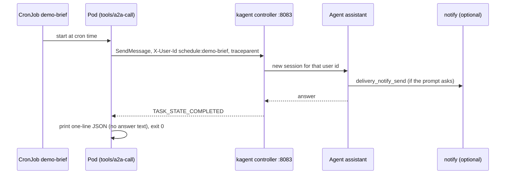

# Schedules

## What it is for

Run an agent on a timetable, such as "every weekday at 08:00". Schedules are declared in values like everything else. They are empty by default, and then the chart renders nothing for them.

## How it works

Each entry of `schedules` renders a prompt ConfigMap `schedule-<name>` and a CronJob in the namespace `openagentix-schedules`. The pod runs `tools/a2a-call`, a Go program that sends one A2A `SendMessage` with `X-User-Id: schedule:<name>` and exits 0 only if the task state is `TASK_STATE_COMPLETED`.



Why not kagent's own scheduler (ADR 0002): it sends no caller identity, so memory-enabled agents fail with "memory requires caller identity", and its runs stuck on a cold agent. It is also gRPC only and has no CRD. The CronJob option was chosen and accepted.

Each schedule has its own memory scope (`schedule:<name>`). Runs are new conversations. The job log never holds the answer text; the answer is in kagent's store (`kagent.session_task`) or in a chat when notify is used.

Hardening: non-root, read-only root filesystem, no capabilities, seccomp `RuntimeDefault`, no service account token. `backoffLimit: 0` (a blind retry repeats cost and side effects), `activeDeadlineSeconds` is the timeout plus 60, `startingDeadlineSeconds: 300`, finished Jobs removed after a day. NetworkPolicies: the controller's port 8083 admits the namespace and the pod label `openagentix.io/component=schedule`; an egress policy lets those pods reach only CoreDNS and the controller.

## How to enable and configure

```yaml
schedules:
  - name: daily-brief                 # DNS label, at most 40 characters, unique
    agent: assistant                  # must be an agents[].name, else the render fails
    schedule: "0 8 * * 1-5"           # 5-field cron, checked at render time
    timeZone: Europe/Berlin           # optional
    prompt: |
      Check the vulnerability database for lodash 4.17.20 and answer in two sentences.
    # optional: userId, timeout (300s), suspend, concurrencyPolicy (Forbid), historyLimits, resources
```

Defaults are in `scheduling.defaults`. The demo file has one suspended schedule, `demo-brief`:

```sh
VALUES_FILE="components/channels/demo-values.yaml components/schedules/demo-values.yaml" ./install.sh
```

`install.sh` builds the image `openagentix/a2a-call:dev` only when the chart renders a CronJob (`SKIP_A2A_CALL_IMAGE=1` skips it). Several values files can be combined; maps merge, lists are replaced, so keep all schedules in one file.

## How to try it

```sh
kubectl create job -n openagentix-schedules --from=cronjob/demo-brief demo-brief-manual-1   # one real model call
kubectl logs -n openagentix-schedules job/demo-brief-manual-1
kubectl get cronjob,job -n openagentix-schedules
```

The log is one line like `{"state":"TASK_STATE_COMPLETED","taskId":...,"durationMs":9279,"answerChars":308,...}`. A failed run prints `a2a-call: FAILED: <reason>` and the Job is `Failed`. With `PRINT_ANSWER=true` the answer is printed too (use with care).

## What was proven

- A manual run, a memory-scoped pair of runs and a real cron firing completed against the memory-enabled `assistant` (ADR 0002 update). This is the case kagent's scheduler failed.
- The demo schedule delivered its result to a real Telegram chat through notify.
- 91 new chart assertions (302 to 393) were written first; `tools/a2a-call` has Go tests.
- Render-time checks: unknown agent, name shape and uniqueness, cron fields, timeout, concurrency policy, time zone.

## Known limits

- Nothing alerts you about a failed run. Look at the Jobs or scrape kube-state-metrics.
- Every firing costs at least one model call. A `* * * * *` schedule spends tokens every minute. The demo schedule is suspended.
- Do not put secrets in a prompt: it is stored in a ConfigMap and sent to the model provider.
- kindnet enforces the egress policy for cluster destinations but not for the internet: a labelled pod still reached example.com. Calico or Cilium enforce it fully.
- With the A2A gate on, each schedule has its own ServiceAccount and token, but that does not keep a pod out: whoever can create pods in `openagentix-schedules` can mount the token of any schedule ServiceAccount there and act as that schedule (and without the gate, anyone who can create a pod with the schedule label can call any agent). The boundary is RBAC for creating pods in that namespace. A ValidatingAdmissionPolicy that ties each pod to its own ServiceAccount is a possible later step and is not built.
- `X-User-Id` is an unauthenticated claim on port 8083.
- ADR 0002 says to re-test kagent's own scheduler on versions newer than 1.0.1 and to open an upstream issue for the two problems it saw.
