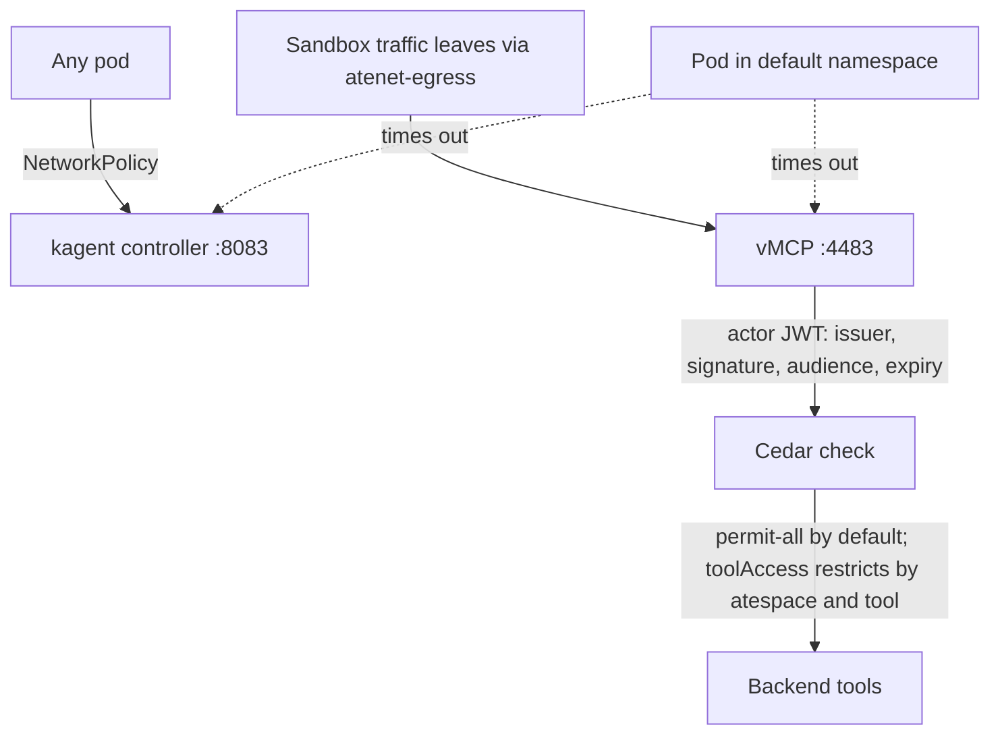
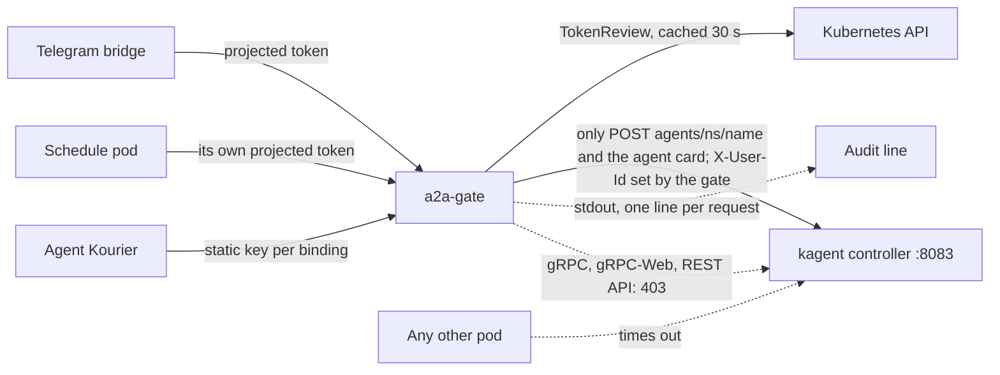
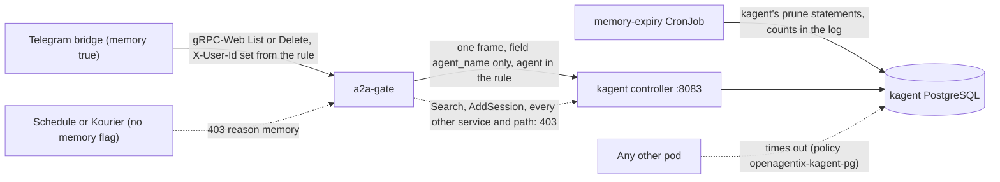
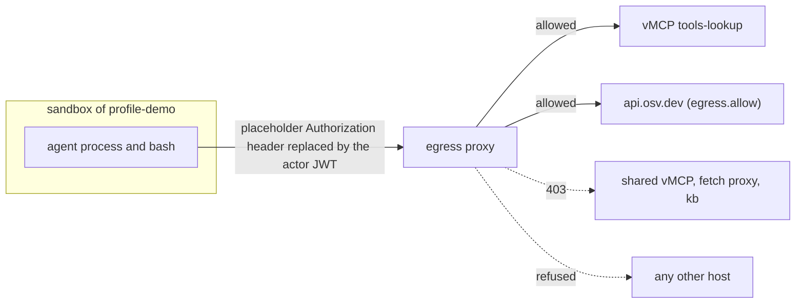

# Security

## What it is for

This page states what is protected, what is not, and how each control was checked. It follows the README "Security" section, checked on kind with kagent 1.0.1, Substrate 1.0.1 and ToolHive 0.67.1. It is a development setup. Read the "not protected" list before you point anything real at it.

## How it works

Controls, from the outside in:

1. **Telegram allowlist.** The bridge refuses to start without `TELEGRAM_ALLOWED_CHAT_IDS`.
2. **Virtual keys.** Agents hold a gateway key, never the provider key.
3. **NetworkPolicies** (chart `networkPolicy.enabled`, default on) for `mcp-tools`, the kagent controller port 8083, the kagent UI (closed to every pod), the knowledge namespace, notify, schedules and Kourier.
4. **Actor JWT** on the tool layer (vMCP `incomingAuth.type: oidc`).
5. **Cedar** tool allowlist (optional `toolAccess`).



Identity detail: kagent creates one Substrate actor per session (`actor/kagent/session-<uuid>`) in the atespace `kagent` for every agent. Substrate issues the JWT with audience `openagentix-vmcp`; the egress proxy adds it to every tool call. The vMCP checks it against `https://idp.ate-system.svc/openid/v1/jwks` with the Substrate service CA (copied by `install.sh` into the ConfigMap `substrate-idp-ca`).

## How to enable and configure

```yaml
networkPolicy:
  enabled: true
  extraA2ACallers: []        # more callers of port 8083: {namespace, podLabels}
mcp:
  virtual:
    incomingAuth:
      type: oidc             # anonymous restores the old behaviour
      toolAccess: []         # list of per-atespace tool allowlist rules, rendered as Cedar
bridge:
  allowlist: {enabled: true}
```

Needs a CNI that enforces NetworkPolicy. kindnet on kind 1.37 does for ingress.

## How to try it

Call the vMCP without a token from a pod: expect 401 from inside `mcp-tools`, a timeout from `default`. From a pod in `default`, calls to the knowledge base, its database and the embedding server time out. A request to `/v1/embeddings` on the gateway without a key gets 401. `components/tools/verify/run-mcp-check.sh` now gets 401 unless `incomingAuth.type=anonymous`.

## The A2A gate (opt-in, ADR 0006 round 1)

By default anything the NetworkPolicy admits can call the kagent controller on port 8083 and name its own user with `X-User-Id`. The A2A gate closes that for the callers the chart knows. It is off by default (`governance.a2a.enabled: false`) and with it off nothing changes: every default and demo render is byte-identical to the one before.

What it is: a small Go reverse proxy (`services/a2a-gate`, standard library only) in `openagentix-gateway`. With the gate on, port 8083 admits only the gate, the Substrate egress proxy and the kagent UI pods. The bridge, every schedule and every Kourier binding call the gate, and each proves who it is:

- **Bridge and schedules:** a projected ServiceAccount token with the audience `openagentix-a2a` (one ServiceAccount per schedule, so a token is limited to one schedule's agent and user id and the audit line names it; this does not stop someone who can create pods in `openagentix-schedules` from mounting any of those ServiceAccounts, see Limits). The gate checks it with a Kubernetes TokenReview and caches a positive answer for 30 seconds. The bridge and `a2a-call` read the token file again on every request, because the kubelet rotates it.
- **Kourier bindings:** a static key per binding. Kourier sends it as `Authorization: Bearer` (and then no `X-User-Id`). The gate compares its SHA-256 with the hashes in a Secret. `install.sh` creates both and never prints them.



What the gate does for each request:

1. No token, a wrong audience or an expired token gets 401.
2. The caller's rule lists the agents it may reach and the user ids it may assert: `exact`, `prefix` (the bridge: `telegram:`) or `fixed` (a Kourier binding: the gate sets it and ignores what was sent). A bridge token that claims `schedule:demo-brief` gets 403.
3. Only `POST /agents/<namespace>/<name>` (and `message:send` and `message:stream` below it) and the agent card `GET` pass. gRPC, gRPC-Web and the REST API get 403, so the controller's memory and session APIs are not reachable through it.
4. `Authorization`, the whole query string (kagent reads `?user_id=` before the header), `Cookie`, `Baggage` and a few identity headers are removed, and `X-User-Id` is set by the gate.
5. SSE passes through with an immediate flush.
6. One JSON audit line goes to stdout: time, caller, agent, user id, `contextId`, trace id, status, duration. The user id is a salted hash by default (`governance.a2a.audit.userId: raw` shows it). The message text is never read beyond a bounded look for `contextId`, and never logged.

Limits, stated plainly:

- The `kagent` namespace peer on port 8083 was narrowed after the review of round 1: only the UI pods (by label), the egress proxy and the gate (or the callers, with the gate off) are peers. The UI itself is closed to every pod, so it is not a way around the gate (see the next section).
- Whoever can create pods in `openagentix-schedules` or in the bridge's namespace can mount the token of any ServiceAccount there. A ServiceAccount per schedule limits one token and names the schedule in the audit line; it is not a boundary between pods. Keep the RBAC for creating pods in those namespaces tight. A ValidatingAdmissionPolicy that ties a pod to its own ServiceAccount is a possible later step and is not built.
- A caller may use only the JSON-RPC methods in its rule. On the JSON-RPC route the whole body must fit in `A2A_GATE_SNIFF_BYTES` (64 KiB by default) and carry one `method`; otherwise the gate answers 403 (`reason: method`). Larger messages use the REST routes.
- The gate caps itself: headers 16 KiB, 10 s for the start of a body, 128 requests at once, TokenReview limits and a pre-check of the token payload.
- The gate trusts the Kubernetes API for tokens. A key in a Secret is as safe as read access to that Secret.
- One replica, no rate limit, no revocation before a token expires (at most one hour for projected tokens).
- `extraA2ACallers` with the gate on needs a matching rule in `governance.a2a.callers`, or the render fails.

```yaml
governance:
  a2a:
    enabled: true
    audit: {userId: hash}      # hash | raw
    callers: []                # extra callers: name, serviceAccount, agents, userId {exact | prefix | fixed}
```

Try it with `VALUES_FILE="components/channels/demo-values.yaml components/schedules/demo-values.yaml components/governance/demo-values.yaml" ./install.sh`. Evidence from the live run is in ADR 0006, "Round 1 results".

## Memory governance (opt-in, ADR 0006 round 3)

Round 3 closes three gaps around long-term memory, each behind a switch that is off by default (with all off, every default and demo render is byte-identical to before). The full explanation is in [Memory](./memory.md); the security side is this:



- **The gate opens two RPCs, for callers that say so.** A caller whose rule has `memory: true` may call `MemoryService` `List` and `Delete` over binary gRPC-Web, and nothing else of gRPC. The user is not in the message: kagent takes it from `X-User-Id`, which the gate sets from the caller's rule as for A2A (a user id outside the rule gets 403). The gate parses the one frame and refuses anything but one `agent_name` that the rule allows, within 600 bytes. Fail closed: a trailer or compressed frame, a second or unknown field, trailing bytes, a slow body, a wrong length all get 403 or 413 and never reach the controller. Each call is one audit line with `rpc` and no content. The bridge gets the flag only when `bridge.memoryCommands` is on.
- **A user can see and delete their own memories.** `/memories` and `/forget confirm` in the Telegram chat, for the chat's own user id. The reply is bounded and the log has only an outcome and a count.
- **Memory expires.** A nightly CronJob runs kagent's own prune statements. The database login is the existing `kagent-postgres-readwrite` Secret by reference. Kagent's PostgreSQL, which was open to every pod, now admits only the controller and this job (`openagentix-kagent-pg`). Whoever can create pods with the job's label in the `kagent` namespace can reach the database, so the boundary is the RBAC for creating pods there.
- **Secret scan, report only by default.** Counts per pattern name; with `secretScanDelete` it removes the rows. A conservative list, not a guarantee.

What this does not protect: the gate trusts the bridge for which chat sent a command (any user id with the `telegram:` prefix), in a group chat any member can forget the group's memories, expired rows are recalled until the job runs, memory is still plain text in a development database, and there is no filter on the save path.

## The kagent UI is closed

The kagent UI proxies `/api/`, `/a2a/` and `/mcp` to the controller and forwards `X-User-Id`, and the controller serves memory, sessions and A2A over gRPC-Web on that path. A pod that reached the UI could therefore do what the gate refuses, with the gate on or off. Before the review of round 1 nothing selected the UI pods, and a pod in `default` got HTTP 200 on the memory List call.

Now `openagentix-kagent-ui` selects the UI pods and admits nobody. Open the UI with `kubectl port-forward -n kagent svc/kagent-ui 8080:8080`: the kubelet connects inside the pod's network namespace, and this works under kindnet (the UI pod also stayed Ready). To let a pod or a proxy in, list it:

```yaml
networkPolicy:
  kagentUI:
    allowFrom:
      - namespace: ops
        podLabels: {app: proxy}   # optional; without it every pod of the namespace
```

This changes the default render on purpose, because it closes a hole. Set `networkPolicy.enabled: false` only if you accept that.

## Tool profiles and egress per agent (opt-in)

Two switches make an agent's limits real instead of advisory (ADR 0006, round 2). Both are off by default and change nothing until you set them.

**Tool profile.** `agents[].toolProfile` takes the agent's tools from a profile vMCP (see the [tools page](./tools.md)). The shared vMCP answers a session with an actor token of the audience `openagentix-vmcp`; a profile has its own audience, and the sandbox of a profile agent has no egress rule for the shared vMCP, so it cannot reach it. A tool outside the profile is not found, in a direct call and in code mode.

**Egress.** A sandbox reaches only what its agent's models and tools imply, the controller, and the origins in `agents[].egress.allow`, which render a kagent `EgressPolicy` and `egressPolicyRefs`. Rules match host and port only, not methods or paths. An entry inside the tools namespace is refused at render time, because it would be a way around the profile.



Proven on kind with the real sandbox (a stub model drove `bash`, so no paid call): the allowed host answered 200; other hosts did not resolve, or got 403 by address; the shared vMCP, the `fetch` proxy and the kb got 403; hidden tools were refused directly and in code mode. A correction to the earlier reading: the egress proxy does not add a token to a request that has none, it replaces an `Authorization` header that is already there. A request without one reaches a vMCP as anonymous and gets 401. With one placeholder header, `bash` is authenticated as the session, so on the shared vMCP a prompt-injected agent can still call any tool; on a profile it can call only the profile's tools.

Limits: `bash` stays on, and the model gateway, the controller and the profile vMCP stay reachable by design. An actor token cannot be revoked before it expires. A profile does not remove its backends from the vMCP's view; it hides their tools.

```yaml
agents:
  - name: profile-demo
    toolProfile: lookup
    egress:
      allow: ["https://api.osv.dev"]
```

## What was proven

- `mcp-tools`: a pod in `default` or another namespace timed out; backends and proxies accept only their own namespace and the ToolHive operator; the vMCP also accepts `atenet-egress` and the controller pod.
- Port 8083 accepts the bridge pod (label `app=telegram-bridge`), the kagent UI pods, `atenet-egress` and Kourier; other pods time out.
- The kagent UI accepts no pod: the memory List call from `default`, `openagentix-gateway` and `kagent` timed out; `kubectl port-forward` to the UI still answers (checked on kind, round 1 review).
- vMCP: 401 without a valid token, also for a malformed token. No `insecure*` flag is set.
- Cedar: with `osv_query_vulnerability` left out of `toolAccess`, deny was logged for it and allow for the others.
- Knowledge namespace: three timeouts from `default`, three from another pod in the namespace, and one from a non-vMCP pod in `mcp-tools`.
- Notify: only vMCP pods reach 8080.

## What is NOT protected

- **The kagent controller does not authenticate callers** (`server.auth.mode: insecure`). The opt-in A2A gate (section above) authenticates the bridge, the schedules and Kourier in front of it; the controller can still be called directly by anything the NetworkPolicy admits (the UI pods, the egress proxy). Setting `serviceAccount.authority: kubernetes` was tried: requests with no token or a garbage token still got 200. It was reverted. Any pod the NetworkPolicy lets through can call any agent, and can claim any `X-User-Id`.
- **No per-agent tool authorization by default.** Cedar tells sessions and atespaces apart, not agents. Default policy is permit-all for any authenticated caller, and code in a sandbox (for example through `bash`) can call the shared vMCP directly: it only needs to send any `Authorization` header, which the egress proxy replaces with the session's token (checked live in round 2). Tool profiles (above) give an agent its own vMCP with a fixed tool list and close the shared one to it.
- A valid actor JWT works until it expires (up to 3600 seconds). No revocation.
- **Global tool discovery is off** with `actorJwt` (`DiscoveryDisabled`).
- The `fetch` tool can reach any URL the pod network allows. The bridge pod, `kagent` and `ate-system` are not restricted.
- **kindnet does not enforce egress to the internet.** In-cluster egress is enforced; internet egress is not (a labelled schedule pod reached example.com).
- Development databases: Substrate's PostgreSQL uses mTLS but is a dev instance; kagent's PostgreSQL has password auth and `sslmode=disable`; RustFS credentials are `rustfsadmin/rustfsadmin`. The gateway is plain HTTP in cluster. Virtual keys are static.
- The Substrate CA copied into `mcp-tools` is read once at install time.
- One Anthropic key is shared by every agent. Saved memories are plain text until someone deletes them.
- Prompt injection is not solved. kb and notify mark retrieved or sent text as data, which is advice to the model, not a filter.
- Nothing here was reviewed for hostile tenants: neither kagent nor AX is ready for them (ADR 0001).

## Known limits

- No audit trail beyond the vMCP `AUDIT` lines in pod stdout.
- No secret rotation, no encryption at rest, no external secret store.
- Governance and guardrails beyond the controls above are not built.
