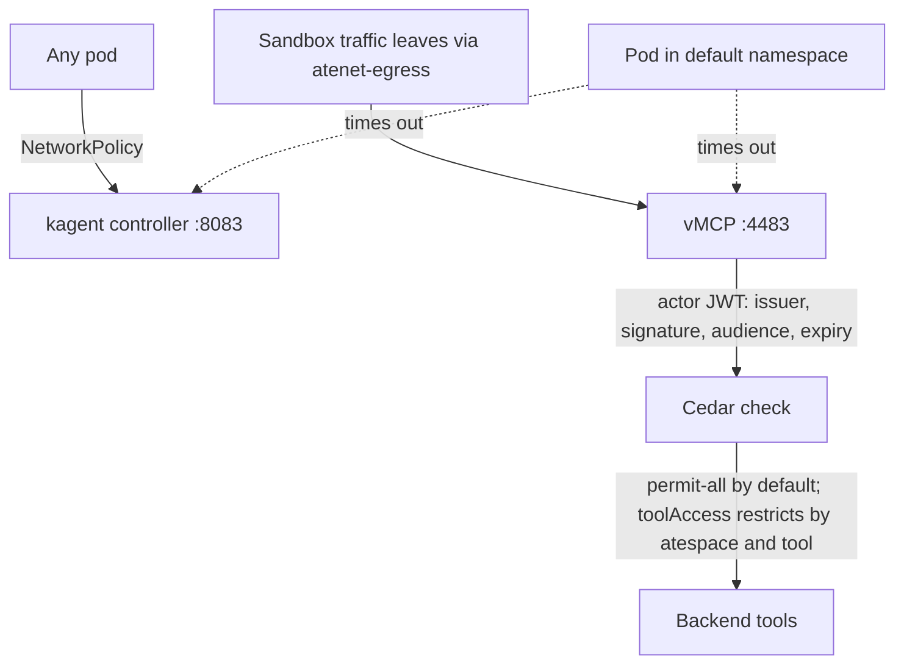

# Security

## What it is for

This page states what is protected, what is not, and how each control was checked. It follows the README "Security" section, checked on kind with kagent 1.0.1, Substrate 1.0.1 and ToolHive 0.67.1. It is a development setup. Read the "not protected" list before you point anything real at it.

## How it works

Controls, from the outside in:

1. **Telegram allowlist.** The bridge refuses to start without `TELEGRAM_ALLOWED_CHAT_IDS`.
2. **Virtual keys.** Agents hold a gateway key, never the provider key.
3. **NetworkPolicies** (chart `networkPolicy.enabled`, default on) for `mcp-tools`, the kagent controller port 8083, the knowledge namespace, notify, schedules and Kourier.
4. **Actor JWT** on the tool layer (vMCP `incomingAuth.type: oidc`).
5. **Cedar** tool allowlist (optional `toolAccess`).



Identity detail: kagent creates one Substrate actor per session (`actor/kagent/session-<uuid>`) in the atespace `kagent` for every agent. Substrate issues the JWT with audience `openagentix-vmcp`; the egress proxy adds it to every tool call. The vMCP checks it against `https://idp.ate-system.svc/openid/v1/jwks` with the Substrate service CA (copied by `install.sh` into the ConfigMap `substrate-idp-ca`).

## How to enable and configure

```yaml
networkPolicy:
  enabled: true
  extraA2ACallers: []        # more callers of port 8083: {namespace, podLabels}
mcp:
  virtual:
    incomingAuth:
      type: oidc             # anonymous restores the old behaviour
      toolAccess: []         # list of per-atespace tool allowlist rules, rendered as Cedar
bridge:
  allowlist: {enabled: true}
```

Needs a CNI that enforces NetworkPolicy. kindnet on kind 1.37 does for ingress.

## How to try it

Call the vMCP without a token from a pod: expect 401 from inside `mcp-tools`, a timeout from `default`. From a pod in `default`, calls to the knowledge base, its database and the embedding server time out. A request to `/v1/embeddings` on the gateway without a key gets 401. `components/tools/verify/run-mcp-check.sh` now gets 401 unless `incomingAuth.type=anonymous`.

## What was proven

- `mcp-tools`: a pod in `default` or another namespace timed out; backends and proxies accept only their own namespace and the ToolHive operator; the vMCP also accepts `atenet-egress` and the controller pod.
- Port 8083 accepts the bridge pod (label `app=telegram-bridge`), the `kagent` namespace, `atenet-egress` and Kourier; other pods time out.
- vMCP: 401 without a valid token, also for a malformed token. No `insecure*` flag is set.
- Cedar: with `osv_query_vulnerability` left out of `toolAccess`, deny was logged for it and allow for the others.
- Knowledge namespace: three timeouts from `default`, three from another pod in the namespace, and one from a non-vMCP pod in `mcp-tools`.
- Notify: only vMCP pods reach 8080.

## What is NOT protected

- **The kagent controller does not authenticate callers** (`server.auth.mode: insecure`). Setting `serviceAccount.authority: kubernetes` was tried: requests with no token or a garbage token still got 200. It was reverted. Any pod the NetworkPolicy lets through can call any agent, and can claim any `X-User-Id`.
- **No per-agent tool authorization.** Cedar tells sessions and atespaces apart, not agents. Default policy is permit-all for any authenticated caller. Whether code in a sandbox (for example through `bash`) could call the vMCP directly was not tested; assume it can.
- A valid actor JWT works until it expires (up to 3600 seconds). No revocation.
- **Global tool discovery is off** with `actorJwt` (`DiscoveryDisabled`).
- The `fetch` tool can reach any URL the pod network allows. The bridge pod, `kagent` and `ate-system` are not restricted.
- **kindnet does not enforce egress to the internet.** In-cluster egress is enforced; internet egress is not (a labelled schedule pod reached example.com).
- Development databases: Substrate's PostgreSQL uses mTLS but is a dev instance; kagent's PostgreSQL has password auth and `sslmode=disable`; RustFS credentials are `rustfsadmin/rustfsadmin`. The gateway is plain HTTP in cluster. Virtual keys are static.
- The Substrate CA copied into `mcp-tools` is read once at install time.
- One Anthropic key is shared by every agent. Saved memories are plain text until someone deletes them.
- Prompt injection is not solved. kb and notify mark retrieved or sent text as data, which is advice to the model, not a filter.
- Nothing here was reviewed for hostile tenants: neither kagent nor AX is ready for them (ADR 0001).

## Known limits

- No audit trail beyond the vMCP `AUDIT` lines in pod stdout.
- No secret rotation, no encryption at rest, no external secret store.
- Governance and guardrails beyond the controls above are not built.
