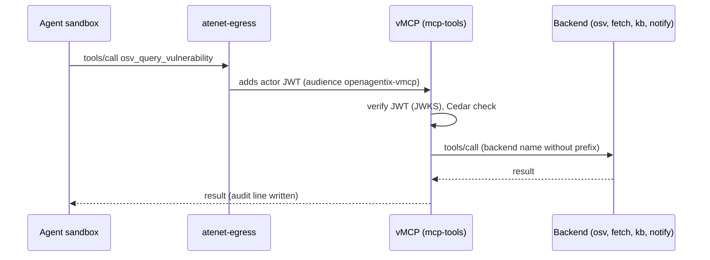
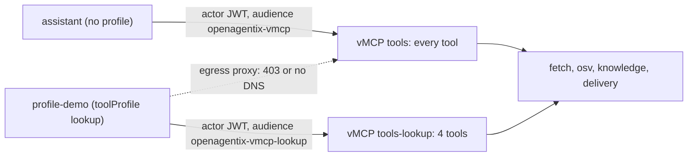

# Tools and skills

## What it is for

Agents reach tools through MCP. ToolHive 0.67.1 runs the MCP servers and one virtual MCP server (vMCP) that aggregates them behind one URL. Code mode adds a tool that runs a short Starlark script, so several tool calls can happen in one model turn. Skills (Agent Skills format) are mounted into the sandbox from OCI images.

## How it works

Namespaces: `toolhive-system` (operator), `mcp-tools` (group, servers, vMCP). The vMCP is the Service `vmcp-tools` on port 4483.



Kinds rendered by the chart: `MCPGroup` `tools`, `MCPServer` `fetch` and `osv`, `VirtualMCPServer` `tools`, `MCPOIDCConfig` `substrate-actor-jwt`, and kagent's `RemoteMCPServer` `toolhive-vmcp`. Other services join the group as `MCPServerEntry` objects with an `MCPExternalAuthConfig` of type `unauthenticated` (the knowledge base entry `knowledge`, the notify entry `delivery`). An entry without that auth config is dropped by the vMCP.

Tool names get the workload as prefix (`prefixFormat: "{workload}_"`): `fetch_fetch`, `osv_query_vulnerability`, `osv_get_vulnerability`, `osv_query_vulnerabilities_batch`, `knowledge_kb_search`, `delivery_notify_send`. An agent's tool allowlist must list them one by one.

**Identity.** `mcp.virtual.incomingAuth.type: oidc` is the default. The RemoteMCPServer asks Substrate for an actor JWT with audience `openagentix-vmcp` (`actorJwt`), and the egress proxy adds it to each tool call. The vMCP checks issuer, signature, audience and expiry (JWKS URL `https://idp.ate-system.svc/openid/v1/jwks`, CA copied by `install.sh` into the ConfigMap `substrate-idp-ca`). Without a valid token the answer is 401.

**Authorization.** The default Cedar policy is `permit(principal, action, resource);`. `mcp.virtual.incomingAuth.toolAccess` turns a per-atespace tool allowlist into Cedar rules.

**Code mode.** With `mcp.virtual.codeMode.enabled`, `tools/list` returns the backend tools plus `execute_tool_script`. Scripts are Starlark. Tools are functions with keyword arguments, and `parallel([...])` is built in. Results come back as a dict with one `text` key holding raw JSON. There is no `json` module, so scripts use string operations.

**Skills.** Top-level `skills` map in values; each entry is an OCI reference that must end in `@sha256:<64 hex>`, or the render fails. `install.sh` builds the example skill `openagentix-canary` and pushes it to its own `registry:2` container `openagentix-registry` on the `kind` Docker network.

## How to enable and configure

```yaml
mcp:
  enabled: true
  servers:
    - {name: fetch, image: "ghcr.io/stackloklabs/gofetch/server:2.0.1", port: 8080}
    - {name: osv,   image: "ghcr.io/stackloklabs/osv-mcp/server:0.2.1", port: 8080}
  virtual:
    codeMode: {enabled: true, stepLimit: 100000, parallelMaxConcurrency: 10, toolCallTimeout: 30s}
    incomingAuth:
      type: oidc
      toolAccess: []          # set a list to replace the permit-all policy
```

Set `mcp.virtual.codeMode.enabled=false` to turn code mode off. Set `incomingAuth.type=anonymous` for the old open behaviour; the RemoteMCPServer then also gets global tool discovery back (with `actorJwt` it shows `DiscoveryDisabled`).

## How to try it

Use the A2A command on the [runtime page](./runtime.md). The agent should call `osv_query_vulnerability`. The vMCP audit lines are in the log of the `tools` pod in `mcp-tools`.

## What was proven

- Backends healthy, `Discovered 5 MCP tools` with the stub setup; a real model answered the lodash question with 4 (README, CHANGELOG).
- Code mode: `execute_tool_script` ran a chain of two OSV calls in one turn with a stub LLM (`components/tools/verify/chain.star`, `verify/out/`).
- Without a token: 401. Cedar with `toolAccess` left out one tool: deny logged for it, allow for the others, and the agent used another tool.
- Skill mounted at `/skills/openagentix-canary/SKILL.md`; the canary prompt returned the skill phrase 5/5 in the runtime comparison.
- Idle footprint of the tool layer: about 112 MiB over 6 pods.

## Tool profiles (opt-in)

By default every agent can call every tool of the one vMCP: the list in `agents[].tools` is a convenience that the agent's own process applies, and `bash` or code mode can still reach the rest. A tool profile moves the real limit into the vMCP.

A profile is one more vMCP on the same tool group. It advertises only the tools you list, it has its own OIDC audience, and agents on it reach it through its own RemoteMCPServer. A hidden tool cannot be called, not even through code mode.

```yaml
mcp:
  profiles:
    - name: lookup
      codeMode: true            # execute_tool_script, limited to this profile's tools
      tools:                    # backend name: that backend's own tool names
        osv: [query_vulnerability, get_vulnerability]
        knowledge: [kb_search]
agents:
  - name: profile-demo
    toolProfile: lookup         # its tools come only from the vMCP tools-lookup
    tools:
      - tools: [execute_tool_script, osv_query_vulnerability, osv_get_vulnerability, knowledge_kb_search]
```



What the render checks: an unknown profile, a tool that is not in the profile, `execute_tool_script` on a profile without `codeMode`, duplicate or invalid profile names, an unknown backend, an empty tool list. The tool names in the profile are the backend's own names (`kb_search`); the agent sees them with the vMCP prefix (`knowledge_kb_search`). Backends that a profile does not name contribute nothing (`defaultToolVisibility: deny`).

Costs and limits:

- One more vMCP pod per profile: about 30 MB of memory and a few millicores idle, and 100m CPU and 128 MiB of requests (measured on kind). The demo ships exactly one profile.
- Every vMCP of the group connects to every backend, so the kb and notify policies admit every profile vMCP. A profile hides tools; it does not cut the network path to a backend.
- Cedar `toolAccess` applies to the shared vMCP only. A profile allows every authenticated call; its filter is the limit.
- `bash` stays on. In a profile agent it can still reach the other origins that the agent's own egress list holds.

Try it: `VALUES_FILE="... components/governance/profiles-demo-values.yaml" ./install.sh` (the file must be last). Evidence is in ADR 0006, "Round 2 results".

## Known limits

- Identity is per session (`actor/kagent/session-<uuid>`, atespace `kagent` for every agent), not per agent. Cedar cannot tell agents apart.
- Code mode: no `json` module; per-call authorization of inner calls was checked only as normal tool calls in the Cedar log.
- A real model choosing code mode on its own is not recorded.
- The optimizer mode (`find_tool`, `call_tool`), `MCPToolConfig` filtering and replicas were not tried.
- Skills: only OCI sources tested. The registry must be reachable over plain HTTP on kind, and its IP can change, so re-run `./install.sh` after recreating the cluster.
- The `fetch` tool can reach any URL the pod network allows.
