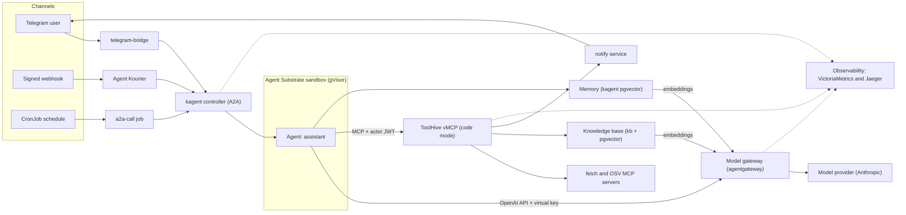

# OpenAgentix feature diary

OpenAgentix is a Kubernetes-native platform for running AI agents. It puts existing open-source projects behind one installer and one Helm chart. The aim in the original product brief is a replacement for the managed agent services of the large clouds, running on your own cluster.

This diary records what was built, how each part was proven, and what is still missing. The current state is an MVP (tag `v0.1.0`) plus work done on 2026-11-22 and 2026-11-23 that is not yet released. It runs on one kind node. Read [what works](./what-works.md) before you rely on anything.

## Component map

An agent never holds a provider key. It holds one virtual key for the model gateway, so cost and budgets are per agent.

Namespaces: `kagent` (controller and agents), `ate-system` (Substrate), `agentgateway-system`, `mcp-tools`, `toolhive-system`, `openagentix-gateway` (bridge), `openagentix-knowledge`, `openagentix-memory`, `openagentix-notify`, `openagentix-channels` and `agent-kourier`, `openagentix-schedules`, `openagentix-observability`, `openagentix-system` (Helm release).

## How it is packaged

Two layers. `install.sh` creates the kind cluster, installs the upstream releases at pinned versions (kagent and Substrate 1.0.1, Gateway API CRDs 1.6.3, agentgateway v1.7.0, ToolHive 0.67.1), makes Secrets from your environment and builds images. The chart `charts/openagentix` then renders only our own resources from values. See [install](./features/install.md).

## Pages

| Page | What it covers |
|---|---|
| [What works](./what-works.md) | One table: every capability, its state, proof, location and main gap |
| [Timeline](./timeline.md) | Dated diary of milestones, oldest first |
| [Runtime](./features/runtime.md) | kagent on Agent Substrate, A2A, why not Google AX |
| [Model gateway](./features/model-gateway.md) | agentgateway, virtual keys, budgets, cost, embedding aliases |
| [Tools](./features/tools.md) | ToolHive vMCP, code mode, skills, tool-layer identity |
| [Knowledge base](./features/knowledge-base.md) | Hybrid search service |
| [Knowledge graph](./features/knowledge-graph.md) | Entities and relations for questions that need several documents |
| [Memory](./features/memory.md) | kagent long-term memory per agent and user |
| [Channels](./features/channels.md) | Telegram bridge, Agent Kourier, webhooks, bindings |
| [Schedules](./features/schedules.md) | CronJobs that call an agent over A2A |
| [Notify](./features/notify.md) | Agents deliver a result to a named chat |
| [Observability](./features/observability.md) | Cost per agent, one trace per turn, audit |
| [Security](./features/security.md) | Identity, network policies, what is not protected |
| [Install](./features/install.md) | install.sh, values files, uninstall, demo values |
| [Maintainer notes](https://github.com/openagentix/openagentix/blob/main/docs/diary/README.md) | How to keep this diary current |

Decision records are in `docs/decisions/`: ADR 0001 (runtime), ADR 0002 (schedules and delivery), ADR 0003 (observability).
